# Analysis of TfL data

Code and data for my MSc Data Analytics dissertation at Queen Mary University of London
(MTHM038, 2023/24): *Analysis of TfL data, with special emphasis on network models*.

The project compares the structure of the London rail network in 2014 and 2024 using five
centrality measures, assesses what the Elizabeth line changed, and studies station
entry/exit counts from 2017 to 2022, including the effect of COVID-19. An
[extended analysis](#extended-analysis) added after submission uses counts up to 2025 to
measure the Elizabeth line's effect on ridership and the network's resilience to closures.
A [TfL bus analysis](#tfl-bus-analysis) adds London's buses: recovery after COVID, the Elizabeth line
from daily data, crowding, and a combined bus + rail network.

> **Submitted version.** The code exactly as it was when the dissertation was submitted
> (1 September 2024) is preserved at the git tag
> [`dissertation-submitted`](../../tree/dissertation-submitted). The dissertation itself is
> unchanged. Everything after that tag is a post-submission revision of the code and results;
> see [Corrections after submission](#corrections-after-submission).

## Key findings at a glance

* **The Elizabeth line reshaped the network's structure.** Remove it from the 2024 network and 29 of the
  30 top-5 centrality positions return to their 2014 values ([details](#4-corrected-results-2014-vs-2024-network)).
* **It also moved passengers.** Its four new central stations grew about **84% more** than comparable
  central-London stations between 2019 and 2023, roughly 70 million extra entries + exits a year
  ([details](#2-the-elizabeth-lines-effect-on-ridership)).
* **It made the network harder to break.** After the 10 most central stations close, the 2024 network keeps
  49% of its efficiency, against 33-34% without the line ([details](#3-resilience-to-station-closures)).
* **Closeness, not betweenness, predicts how busy a station is** (Spearman rho 0.66-0.71 vs 0.28-0.36)
  ([details](#1-does-centrality-predict-ridership)).
* **Buses are losing passengers while the Tube holds steady.** Since mid-2023 bus journeys have fallen about
  2.2% a year; the Tube is flat. Service cuts explain about a quarter of the bus fall
  ([details](#1-bus-vs-tube-recovery)).
* **Daily data confirms the Elizabeth line effect.** Footfall at the new central stations jumped about 42% in
  the opening weeks and reached +88% after three years, relative to nearby stations
  ([details](#2-the-elizabeth-line-day-by-day)).
* **Bus crowding is a suburban, school-time problem,** worst far from rail and rising as service is cut
  ([details](#4-bus-crowding)).
* **Buses make the rail network much harder to break.** After the 10 most central rail stations close,
  travel between the rest keeps 76% of its efficiency with buses, against 47% on rail alone
  ([details](#5-a-combined-bus--rail-network)).

<picture>
  <source media="(prefers-color-scheme: dark)" srcset="figures/centrality-overlap-dark.png">
  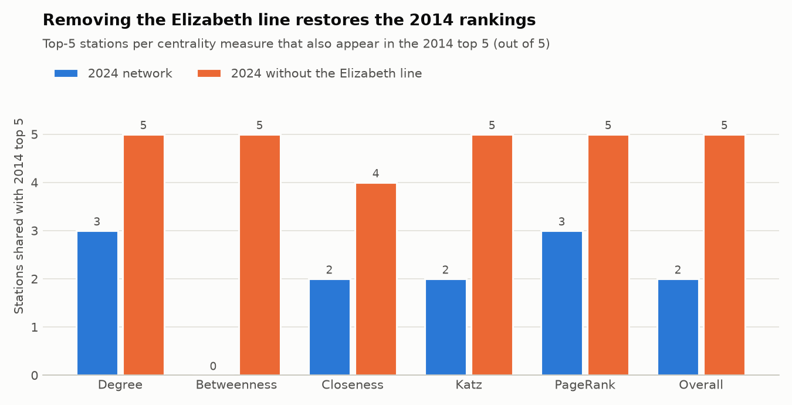
</picture>

<picture>
  <source media="(prefers-color-scheme: dark)" srcset="figures/elizabeth-line-did-dark.png">
  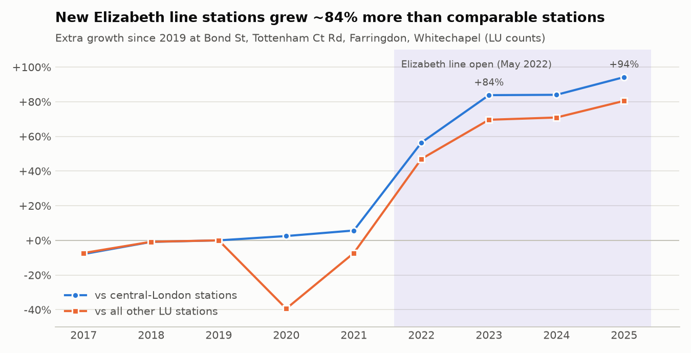
</picture>

## Repository layout

| Path | Contents |
|---|---|
| `python-notebooks/tfl-2014-centrality.ipynb` | 2014 network (Tube, Overground, DLR) and its centrality measures |
| `python-notebooks/tfl-2024-centrality.ipynb` | 2024 network, its centrality measures, and the like-for-like 2014 vs 2024 comparison |
| `python-notebooks/tfl-passenger-flow.ipynb` | Annual and time-of-day station entry/exit analysis, 2017-2022 |
| `python-notebooks/extended-analysis.ipynb` | Centrality vs ridership, Elizabeth line difference-in-differences, network resilience |
| `python-notebooks/tfl_analysis.py` | Logic shared by the notebooks above |
| `python-notebooks/bus-*.ipynb`, `elizabeth-line-daily.ipynb` | [TfL bus analysis](#tfl-bus-analysis) |
| `python-notebooks/tfl_bus.py` | Logic shared by the bus notebooks: data loaders, coordinate conversion, bus + rail network |
| `python-notebooks/data-prep/` | How the 2024 network and station coordinates were built, including `fix_station_coordinates.py`; `download_tfl_bus.py` fetches the bus analysis data |
| `results/` | CSV outputs written by the notebooks (`results/bus/` for the bus analysis) |
| `figures/` | README charts, built from `results/` by `python-notebooks/make_readme_figures.py` |
| `data/` | 2024 network edges/stations, TfL station locations and counts (see [`data/README.md`](data/README.md)) |
| `data/bus/` | Manifest of the downloaded bus analysis data, with source links (see [`data/bus/README.md`](data/bus/README.md)) |
| `References/London_Multiplex_Transport/` | 2014 network: De Domenico et al. multiplex dataset |
| `python-notebooks/archive/` | Exploratory notebooks from the dissertation period, not used for any result |

## Running

```bash
python -m venv .venv && source .venv/bin/activate
pip install -r requirements.txt
cd python-notebooks
jupyter nbconvert --to notebook --execute --inplace tfl-2014-centrality.ipynb tfl-2024-centrality.ipynb \
    tfl-passenger-flow.ipynb extended-analysis.ipynb
python make_readme_figures.py   # rebuilds the charts in figures/ from results/
python data-prep/fix_station_coordinates.py --refresh   # optional: re-download TfL station locations

# bus analysis: download the data (~3.7 GB, kept as ~650 MB locally), then run the notebooks in order
python data-prep/download_tfl_bus.py all
jupyter nbconvert --to notebook --execute --inplace bus-routes-stops.ipynb bus-eda.ipynb \
    bus-tube-recovery.ipynb elizabeth-line-daily.ipynb bus-demand-change.ipynb bus-crowding.ipynb \
    bus-rail-network.ipynb   # the last one takes about 20 minutes
```

Each notebook runs top to bottom from a fresh kernel and writes its tables to `results/`.

## Data sources

* **2024 network:** `data/2022-tfl-edges.csv` and `data/tfl_stations_2022_with_coordinates.csv`,
  built for this project from TfL line and station information. Station locations come from the
  [TfL Unified API](https://api.tfl.gov.uk/).
* **2014 network:** the London multiplex transport dataset of M. De Domenico, A. Solé-Ribalta,
  S. Gómez and A. Arenas, *Navigability of interconnected networks under random failures*,
  PNAS 111 (2014) 8351-8356 (licences in `References/London_Multiplex_Transport/`).
* **Passenger counts:** TfL annual station counts (`AnnualisedEntryExit_<year>.xlsx`, 2017-2025) and
  quarter-hourly counts (`ByQhrEntryExit_<year>.xlsx`, 2017-2021), from
  [TfL's crowding data](https://crowding.data.tfl.gov.uk/). *Powered by TfL Open Data.*
* **Bus analysis:** TfL Network Demand, BUSTO, bus stop and sequence feeds and the Unified API; see
  [Data for the bus analysis](#data-for-the-bus-analysis).

## Corrections after submission

### 1. Centrality results reported for 2014

Two of the 2014 top-5 lists in the dissertation (§4.1.1) were copied from the wrong measure:

| Measure | Dissertation | Code output |
|---|---|---|
| Degree | Green Park, Westminster, Bond Street, King's Cross, Oxford Circus *(the closeness list)* | Bank and Monument, Baker Street, King's Cross, Stratford, Canning Town |
| Katz | Oxford Circus, Green Park, Piccadilly Circus, Bond Street, Westminster *(the eigenvector list)* | Bank and Monument, Baker Street, King's Cross, Green Park, Stratford |

In 2014, six stations (Canning Town, Earl's Court, Green Park, Oxford Circus, Waterloo,
West Ham) tie for 5th place on degree with 6 neighbours each, so the last place in the degree
top 5 depends on an arbitrary (alphabetical) tie-break. The notebooks now report ties
(`tied_at_cutoff`).

### 2. One method for the "overall" ranking

The dissertation (Eq. 4.2) defines the overall score as the number of top-5 lists a station
appears in. The 2014 code instead used rank points times appearances / 5, *and used eigenvector
centrality in place of Katz*. The 2024 code used a third rule. Both notebooks now use Eq. 4.2,
with ties broken by summed rank points and then mean percentile (`tfl_analysis.combined_ranking`).

### 3. The two networks are now built the same way

* **Interchanges.** The 2014 data split some station complexes (`bank` / `monument`, three
  `edgwareroad(...)` nodes, two `hammersmith(...)` nodes, two Paddington nodes) that the 2024
  data merges. The 2024 data also listed some DLR platforms separately (`Canary Wharf DLR`,
  `Shadwell DLR`, ...) that the 2014 data merges. Both years now use one node per station
  complex, and 2014 labels are mapped to 2024 names.
* **Trams.** The 2024 graph includes London Trams, which the 2014 data does not have. The
  39-stop tram network is also not connected to the rest of the 2024 graph. The comparison
  below therefore uses 2024 without trams. Removing them changes none of the 2024 top-5 lists.

### 4. Corrected results: 2014 vs 2024 network

| Measure | 2014 | 2024 (no trams) | 2024 without Elizabeth line |
|---|---|---|---|
| Degree | Bank and Monument, Baker Street, King's Cross, Stratford, Canning Town | Stratford, Bank and Monument, Liverpool Street, Baker Street, Canary Wharf | Bank and Monument, Baker Street, King's Cross, Stratford, Canning Town |
| Betweenness | Bank and Monument, King's Cross, Waterloo, Green Park, Euston | Liverpool Street, Farringdon, Bond Street, Stratford, Tottenham Court Road | Bank and Monument, King's Cross, Waterloo, Euston, Green Park |
| Closeness | Green Park, Westminster, King's Cross, Bond Street, Oxford Circus | Farringdon, Liverpool Street, Tottenham Court Road, Bond Street, King's Cross | Green Park, King's Cross, Bank and Monument, Westminster, Oxford Circus |
| Katz | Bank and Monument, Baker Street, King's Cross, Green Park, Stratford | Stratford, Liverpool Street, Bank and Monument, Whitechapel, Canary Wharf | Bank and Monument, Baker Street, King's Cross, Green Park, Stratford |
| PageRank | Stratford, Bank and Monument, King's Cross, Baker Street, Canning Town | Stratford, Bank and Monument, Liverpool Street, King's Cross, Canary Wharf | Stratford, Bank and Monument, King's Cross, Baker Street, Canning Town |
| **Overall** | King's Cross, Bank and Monument, Baker Street, Green Park, Stratford | Liverpool Street, Stratford, Bank and Monument, Canary Wharf, Farringdon | Bank and Monument, King's Cross, Baker Street, Green Park, Stratford |

**Finding.** Removing only the Elizabeth line from the 2024 network restores **29 of the 30**
2014 top-5 positions. With the line included, only 12 of 30 match. The shift in centrality
between 2014 and 2024 is therefore caused almost entirely by the Elizabeth line, not by the
other network changes over the decade. This supports the dissertation's main conclusion more
directly than the original analysis did. Centrality describes network *structure* only, so
it cannot by itself show changes in passenger flow or the effect of local development.

Betweenness rank (1 = highest) of selected stations:

| Station | 2014 | 2024 | 2024 without Elizabeth line |
|---|---|---|---|
| Farringdon | 86 | 2 | 92 |
| Tottenham Court Road | 253 | 5 | 270 |
| Whitechapel | 193 | 9 | 204 |
| Liverpool Street | 12 | 1 | 13 |
| Bank and Monument | 1 | 23 | 1 |
| Green Park | 4 | 29 | 5 |

<picture>
  <source media="(prefers-color-scheme: dark)" srcset="figures/betweenness-ranks-dark.png">
  
</picture>

Full tables: `results/centrality_top5_comparison.csv`, `results/betweenness_rank_key_stations.csv`.

### 5. Passenger counts comparable across years

The submitted code added LU station entry/exit counts to Overground, DLR and TfL Rail
*boarding/alighting* counts. It dropped TfL Rail rows for 2017-2019 but kept the same service
(listed as `EZL`) for 2020-2022. Also, from 2022, TfL folds shared-station passengers into
the LU gate count (`---see LU---` rows). Totals and rankings therefore were not comparable
between years. All passenger figures now use **LU station entry/exit gate counts only**:
the one series published on the same basis for 2017-2022 (264-266 stations per year).

| Year | 2017 | 2018 | 2019 | 2020 | 2021 | 2022 |
|---|---|---|---|---|---|---|
| LU entries + exits (bn) | 2.776 | 2.748 | 2.843 | 1.015 | 1.168 | 2.147 |

<picture>
  <source media="(prefers-color-scheme: dark)" srcset="figures/lu-totals-dark.png">
  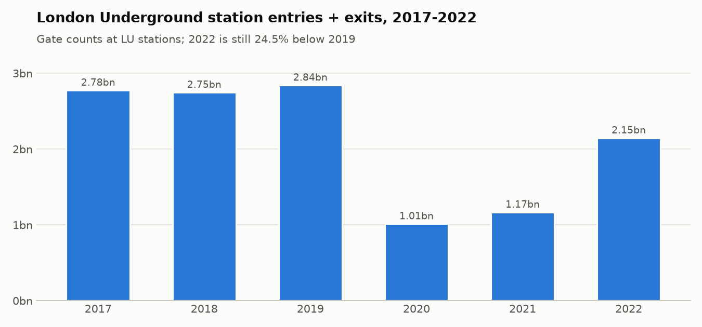
</picture>

Top stations change accordingly. Before COVID they were King's Cross St. Pancras, Victoria,
Waterloo, Oxford Circus and London Bridge. Stratford tops only 2020 (25.1M), and Canning Town
is not in any year's top 5 (`results/top5_stations_by_year.csv`).

**Farringdon vs Green Park.** The whole LU network fell 22.7% between 2017 and 2022. Measured
as a share of all LU traffic:

| Station | 2017 | 2022 | Raw change | Change relative to network |
|---|---|---|---|---|
| Farringdon | 19.3M | 30.1M | +55.6% | **+101%** (share 0.70% → 1.40%) |
| Tottenham Court Road | 39.2M | 49.0M | +24.9% | +62% |
| Whitechapel | 13.1M | 14.3M | +8.6% | +40% |
| Bond Street | 36.9M | 35.4M | −3.9% | +24% |
| Green Park | 37.4M | 28.4M | −24.0% | −2% |

Green Park's fall matches the network-wide post-COVID drop, so it does not show Green Park
becoming less central. The Elizabeth line stations, by contrast, roughly doubled
(Farringdon) or substantially grew their share of traffic. Bank and Monument's 2022 figure
(−25% relative to the network) is also affected by the 2022 Bank station closure works.

<picture>
  <source media="(prefers-color-scheme: dark)" srcset="figures/station-share-change-dark.png">
  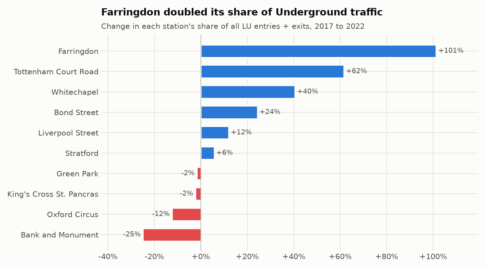
</picture>

**Time of day.** On LU weekdays, the AM peak share fell from 25.8% (2019) to 23.4% (2021)
while inter-peak rose from 25.8% to 27.1% (`results/lu_typical_day_profile.csv`). 2017 is
published as a Monday-Friday profile and 2018 onwards as Monday-Thursday.

<picture>
  <source media="(prefers-color-scheme: dark)" srcset="figures/weekday-profile-dark.png">
  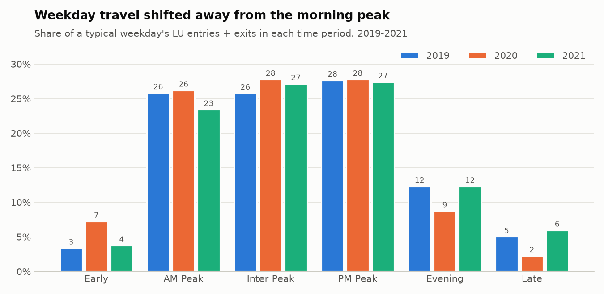
</picture>

### 6. Other code fixes

* The passenger-flow notebook had a cell that raised `KeyError` and had been run out of order.
  All three notebooks now run top to bottom from a fresh kernel.
* The 2024 notebook relied on a global graph `G` that was emptied and re-filled between cells.
  It now builds graphs explicitly.

### 7. Station coordinates

The coordinates in `data/tfl_stations_2022_with_coordinates.csv` were originally geocoded by name with
the Google Maps API, and **76 stations were more than 1 km out**. Queensbury resolved to New York State,
and whole stretches of the District, Central and tram lines were displaced. Every station now takes its
location from TfL's own Unified API, matched by name *and* mode (`python-notebooks/data-prep/fix_station_coordinates.py`;
every change is logged in `data/coordinate-fixes.csv`).

Checked against the independent 2014 dataset, all 364 shared stations are now within 419 m (median 35 m),
down from 55 stations more than 1 km off. No earlier result depended on these coordinates: the network
analysis uses station connections only. The extended analysis uses them to define the control group.

<picture>
  <source media="(prefers-color-scheme: dark)" srcset="figures/network-map-dark.png">
  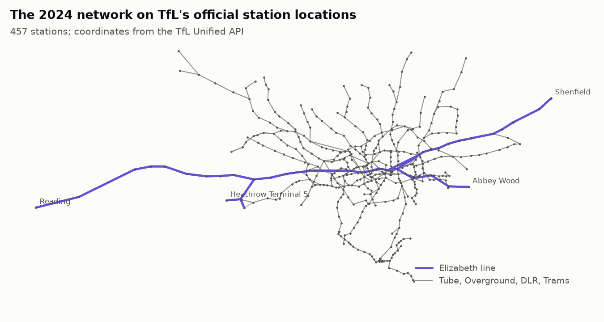
</picture>

## Extended analysis

Added after submission; see [`python-notebooks/extended-analysis.ipynb`](python-notebooks/extended-analysis.ipynb).
It uses TfL station counts up to **2025**. TfL changed how it counts twice: modelled estimates in 2017,
ticket-gate counts 2018-2023, and card taps from 2024. The main comparisons therefore use **2019 vs 2023**,
both gate counts.

### 1. Does centrality predict ridership?

Spearman rank correlation between each centrality measure and annual LU entries + exits (263-264 stations):

| Measure | 2014 network vs 2019 ridership | 2024 network vs 2023 ridership |
|---|---|---|
| Closeness | 0.71 | 0.66 |
| Katz | 0.60 | 0.61 |
| Degree | 0.51 | 0.56 |
| Betweenness | 0.36 | 0.28 |
| PageRank | 0.17 | 0.24 |

<picture>
  <source media="(prefers-color-scheme: dark)" srcset="figures/centrality-vs-ridership-dark.png">
  
</picture>

Closeness (how few stops a station is from everywhere else) is the best predictor of how busy a station is.
Betweenness, the measure the dissertation relied on most, is much weaker. Being on many shortest routes says
more about interchange load inside the network than about how many people start or end journeys at a station.

### 2. The Elizabeth line's effect on ridership

A **difference-in-differences** design compares how much station traffic changed at Elizabeth line stations
with how much it changed at similar stations without the line.

* **Treated:** the four new central stations whose Elizabeth line passengers pass through the LU ticket gates
  (TfL marks them `---see LU---`): Bond Street, Tottenham Court Road, Farringdon, Whitechapel.
* **Control:** the 56 other LU stations within 4 km of them, so both groups shared central London's slow
  post-COVID recovery. A version with every other LU station is shown for comparison.
* Paddington and Liverpool Street are reported separately: the earlier TfL Rail service was counted
  separately there until 2022. Stratford and Ealing Broadway are excluded, because TfL Rail already served them.

| | 2019 → 2023 |
|---|---|
| Extra growth at the four stations vs control | **+84%** (95% CI +56% to +117%) |
| Placebo test: 10,000 random groups of four control stations | none as large; largest +27%, p = 0.0001 |
| Extra entries + exits in 2023 at the four stations | about 70 million |

The year-by-year chart under [Key findings](#key-findings-at-a-glance) shows the treated and control stations
moving together before the line opened (2018: −1%; 2020-21 within 6%). The effect appears in 2022, the year it
opened, and holds through 2025 (+94%). 2017 sits lower (−8%), but 2017 counts are modelled rather than gate
counts, and Farringdon's 2018 jump coincides with the Thameslink upgrade.

| Station | 2019 | 2023 | 2025 | vs control, 2019 → 2023 |
|---|---|---|---|---|
| Farringdon | 25.9M | 40.1M | 42.0M | +118% |
| Tottenham Court Road | 42.0M | 58.7M | 60.8M | +97% |
| Whitechapel | 13.1M | 17.5M | 17.9M | +88% |
| Bond Street | 37.5M | 37.4M | 42.3M | +41% |
| *Paddington* | 48.6M | 48.5M | 58.0M | *+41%* |
| *Liverpool Street* | 67.2M | 57.2M | 60.1M | *+20%* |
| *Canary Wharf (LU station)* | 47.7M | 30.9M | 32.6M | *−9%* |

This measures traffic *through these stations*, including passengers who switched from nearby stations. It
is not an estimate of new journeys across the whole network. Canary Wharf's Underground station lost ground
as passengers moved to the separate Elizabeth line station next door.

### 3. Resilience to station closures

**Network efficiency** is the average of 1 / (number of stops) over all pairs of stations: it falls as
stations close, and it stays meaningful when the network splits into pieces.

<picture>
  <source media="(prefers-color-scheme: dark)" srcset="figures/resilience-dark.png">
  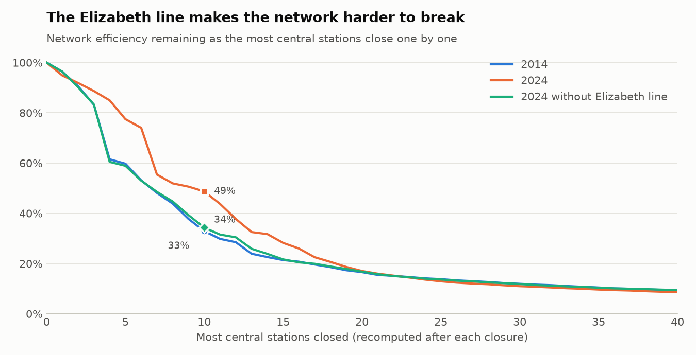
</picture>

* **Targeted closures:** close the most central station (highest betweenness, recomputed after each
  closure). After 10 closures, the 2024 network keeps **49%** of its efficiency, against **33%** in 2014 and
  **34%** for 2024 without the Elizabeth line. The line adds a second east-west trunk, so traffic has another
  way across London. The advantage disappears by about 20 closures, when every version is badly fragmented.
* **Random closures** are much less damaging: about 9% of efficiency lost after 10, and about a third after 40,
  in every version.
* **The flip side is concentration at Stratford.** It is the single most damaging closure in 2024 (12.3% of
  efficiency lost, up from 9.0% in 2014). Euston, Camden Town, Leyton and Leytonstone follow, the last two
  because the Central line's Epping and Hainault branches depend on them.

Full outputs: `results/centrality_vs_ridership.csv`, `results/elizabeth_line_*.csv`, `results/resilience_*.csv`.

## TfL bus analysis

Added after the rail analysis: London's bus network, daily journey data up to November 2026, and a
combined bus + rail network. Everything uses TfL open data and is reproducible from the download script
(see [Data for the bus analysis](#data-for-the-bus-analysis)). "Rail" means TfL rail throughout
(Underground, Overground, DLR, Elizabeth line; no trams, no National Rail), as in the rail analysis.

| Notebook | What it covers |
|---|---|
| [`bus-routes-stops.ipynb`](python-notebooks/bus-routes-stops.ipynb) | Matches bus stops and routes across BUSTO, TfL's feeds and the API; links every bus stop to rail |
| [`bus-eda.ipynb`](python-notebooks/bus-eda.ipynb) | First look at every dataset: recovery, strikes, footfall, what the BUSTO measures mean |
| [`bus-tube-recovery.ipynb`](python-notebooks/bus-tube-recovery.ipynb) | Bus vs Tube recovery after COVID |
| [`elizabeth-line-daily.ipynb`](python-notebooks/elizabeth-line-daily.ipynb) | The Elizabeth line's effect from daily station data |
| [`bus-demand-change.ipynb`](python-notebooks/bus-demand-change.ipynb) | Where bus demand fell since 2023-24, and near the Elizabeth line |
| [`bus-crowding.ipynb`](python-notebooks/bus-crowding.ipynb) | When, where and on which routes buses are crowded |
| [`bus-rail-network.ipynb`](python-notebooks/bus-rail-network.ipynb) | Combined bus + rail network: accessibility, centrality, resilience |

### 1. Bus vs Tube recovery

Daily journeys compared with the same month and day of the week in 2019, with strikes and bank
holidays removed.

<picture>
  <source media="(prefers-color-scheme: dark)" srcset="figures/bus-tube-recovery-dark.png">
  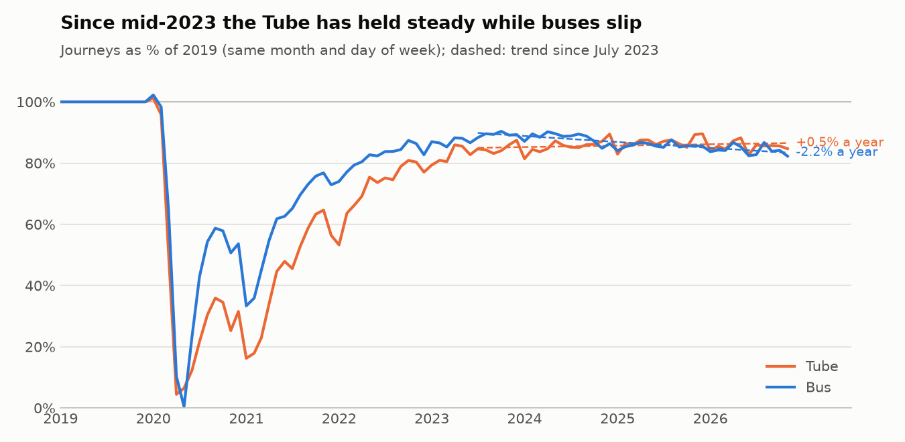
</picture>

* **The two modes have diverged.** Since July 2023 the Tube has been flat (+0.5% a year, 95% CI -0.1% to
  +1.2%) while **bus journeys have fallen 2.2% a year** (CI -2.6% to -1.9%). Buses were at 88% of 2019 in
  2023-24 and 84% in 2026; in 2025 they fell below the Tube (86% vs 87%). The decline began around
  **September 2024**, since when bus journeys have been below the year before in every month.
* **The shortfalls differ.** The Tube is missing weekday commuters, most on Mondays and Fridays (78% of
  2019, against 84-85% mid-week); at weekends it is back to 2019. Buses are 82-84% of 2019 on every
  weekday and below 2019 at weekends too (90-95%), so their decline is not a working-from-home effect.
* **Service cuts explain about a quarter of the bus fall.** Bus capacity on unchanged route-stops fell
  3.3% on weekdays between 2023-24 and 2025-26 (BUSTO); demand falls about 0.6% for each 1% of capacity,
  which accounts for about 2 of the 7.8 points lost.
* **Buses absorb few Tube passengers.** On the 11 full Tube strike days since 2022, bus journeys rose only
  5-15%.

| | 2019 | 2022 | 2023 | 2024 | 2025 | 2026 |
|---|---|---|---|---|---|---|
| Tube (% of 2019) | 100 | 72.5 | 83.7 | 85.5 | 86.8 | 85.5 |
| Bus (% of 2019) | 100 | 82.1 | 88.2 | 88.3 | 85.8 | 84.3 |

### 2. The Elizabeth line, day by day

The [annual analysis](#2-the-elizabeth-lines-effect-on-ridership) found the four new central stations
grew about 84% more than nearby stations between 2019 and 2023. Daily station footfall (entry + exit
taps, weekdays, strikes and holidays removed) shows when that happened. Each station is compared with
48 central Underground stations, relative to its own 16 weeks before opening.

<picture>
  <source media="(prefers-color-scheme: dark)" srcset="figures/elizabeth-line-daily-dark.png">
  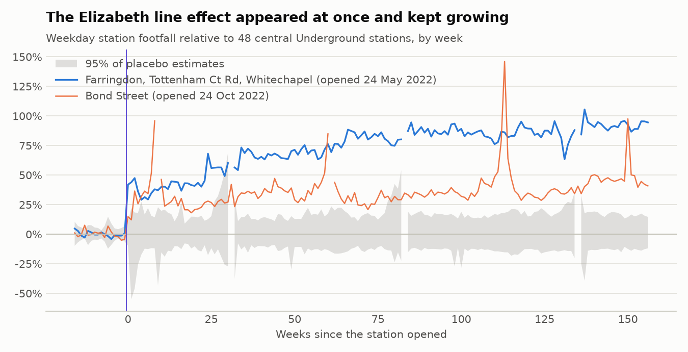
</picture>

| After opening | Farringdon, Tottenham Court Road, Whitechapel (24 May 2022) | Bond Street (24 Oct 2022) |
|---|---|---|
| 16 weeks before | 0.0% | +0.1% |
| first 4 weeks | **+42%** | +22% |
| weeks 27-52 | +65% | +34% |
| year 2 | +82% | +34% |
| year 3 | **+88%** | +44% |

* **The effect was immediate**, with no movement before opening, and grew in steps with through services
  (November 2022) and the full timetable (May 2023). By station, year 3: Farringdon +130%, Tottenham
  Court Road +95%, Whitechapel +47%, Bond Street +44%.
* **It is not chance.** In an exact placebo test, no set of control stations comes close: p = 0.0001 over
  all 17,296 sets for the central three, and p = 0.02, the smallest possible with 48 placebos, for Bond
  Street. (Bond Street's December spikes are West End Christmas shopping.)
* **It matches the annual analysis:** 2019 to 2023 gives +73% from daily weekday taps vs +84% from annual
  counts, and 2019 to 2025 +91% vs +94%.
* **Part of it is passengers moving from nearby stations,** which fell 4-9% relative to stations further
  away. Comparing only with stations more than 1 km away gives +82% in year 3 instead of +88%.
* The Northern line Bank branch (Kennington to Angel) is left out of the control group: it was closed
  from January to May 2022, exactly the period before the opening.

### 3. Where bus demand fell, and the Elizabeth line

BUSTO bus demand starts in 2023-24, after the Elizabeth line opened, so it cannot give a before/after
for buses. It can show where bus demand changed since then.

* **The fall is a loss of passengers, not route changes.** Weekday boardings fell 6.7% from 2023-24 to
  2025-26 (Saturday 5.6%, Sunday 2.3%). On route-stops served in both years the fall was 7.8%; new routes,
  mainly the Superloop (+3%), slightly outweighed withdrawn ones.
* **It is widespread,** largest 3-6 km from the centre (-10.5% on weekdays) and at night (-13%).
* **Near the Elizabeth line, demand held up slightly better, mostly at the stations' doorstep.** The raw
  gap (-1.5% near the line vs -7.1% elsewhere) is mostly geography and new routes. Comparing stops on the
  same route, with distance from the centre and capacity changes controlled for, stops near the line did
  about 2-3% better than stops away from rail at 400 m (not significant), but **7.6% better within 200 m**
  of a central-section station (95% CI +2.5% to +12.9%). Stops near other TfL rail stations did no better.

<picture>
  <source media="(prefers-color-scheme: dark)" srcset="figures/bus-change-near-elizabeth-line-dark.png">
  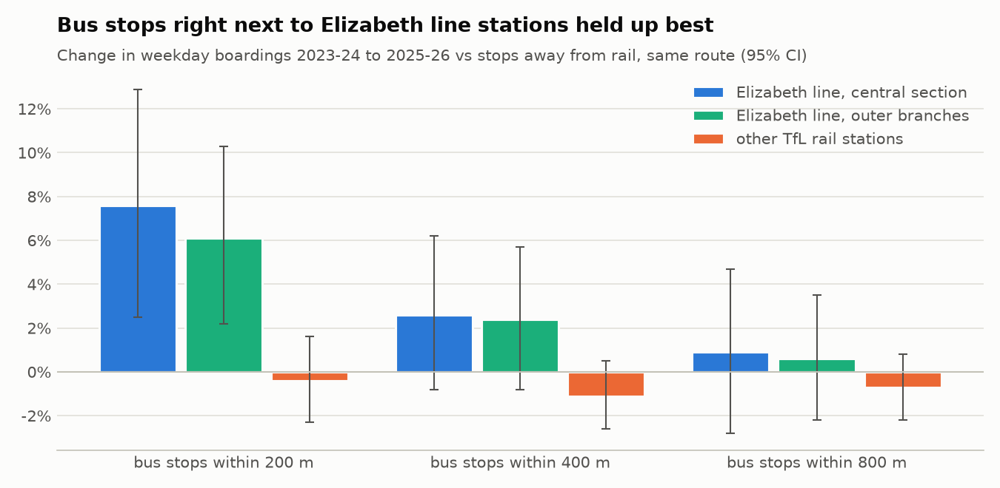
</picture>

### 4. Bus crowding

Crowding = more passengers on board than seats in a route-stop's busiest hour (BUSTO's "max demand
hour" files), counting only hours with at least about two buses. BUSTO gives typical-day averages, so
this shows where crowding is systematic rather than on individual buses.

<picture>
  <source media="(prefers-color-scheme: dark)" srcset="figures/bus-crowding-dark.png">
  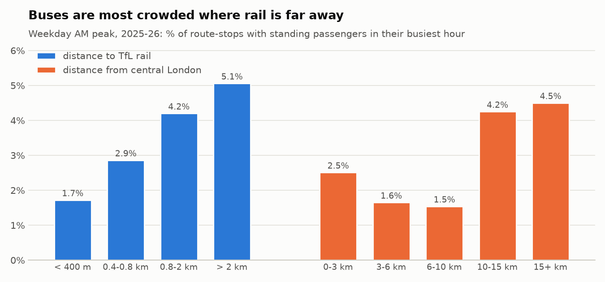
</picture>

* **A weekday morning problem.** 3.5% of route-stops have standing in their busiest AM-peak hour (5% of
  AM-peak passengers are on them), against about 1.4% in the inter-peak and PM peak and almost none in
  the evening or at weekends. Buses at 80%+ of total capacity are very rare in the averages.
* **School travel drives much of it.** Morning crowding peaks in the hour from 07:30, and 99% of
  inter-peak crowding is in the hour starting 15:15-15:45, just after schools finish.
* **Suburban routes, away from rail.** The most crowded routes are 493, 117, 152, K1, W19, 167 and E10.
  Stops more than 800 m from rail are 2-2.5 percentage points more likely to have standing than stops
  near rail, even allowing for distance from the centre.
* **Crowding rose as service was cut:** AM-peak standing went from 2.9% of route-stops in 2023-24 to 3.5%
  in 2025-26 while passengers fell. Routes whose capacity was cut by more than 10% lost 14% of their
  passengers yet became more crowded.

### 5. A combined bus + rail network

10,273 bus stop areas (stops on both sides of the road) and 418 rail stations, joined by 2,446 walking
links (up to 400 m). Edges are weighted by estimated travel time: bus 15 km/h on road distance, rail
30 km/h, walking 4.8 km/h plus 5 minutes to change mode. There is no timetable, so travel times are
best read as relative.

* **Rail cuts average journey times by about a third:** 79 minutes from a typical stop area to all others
  with rail, 116 by bus alone. Rail saves most in outer London (45 min) and least in south London, where
  TfL rail is sparse.
* **Buses change which rail stations matter most** (Spearman 0.74 with the rail-only ranking). The top
  stations are those where large bus catchments meet fast rail: Canada Water, London Bridge, Surrey Quays,
  Earl's Court, Liverpool Street, Bank and Monument. Bus interchanges at the edge of the rail network rise
  sharply (West Croydon, Norwood Junction, Woolwich, Abbey Wood); stations beyond the bus network fall.
  *Caveat:* without National Rail, the Overground through south-east London is the only fast route there
  in the model, which lifts its stations (New Cross Gate, Brockley, Forest Hill) by 100-160 places.
* **Buses soften rail closures.** After the 10 most central rail stations close, travel between the
  remaining stations keeps 47% of its efficiency on rail alone but 76% with buses.
* **Local dependence on single routes.** No one bus route matters for the network as a whole (at most 1%
  of efficiency), but 388 of 606 routes are the only link for at least one stop area, and 37% of stop
  areas are served by one route: 21% within 400 m of rail, 47% more than 2 km away.
* Rankings are stable for bus speeds of 12-18 km/h, rail 25 km/h, change penalties of 2-10 minutes and
  200 m walking links (Spearman 0.97-1.00).

<picture>
  <source media="(prefers-color-scheme: dark)" srcset="figures/bus-rail-closures-dark.png">
  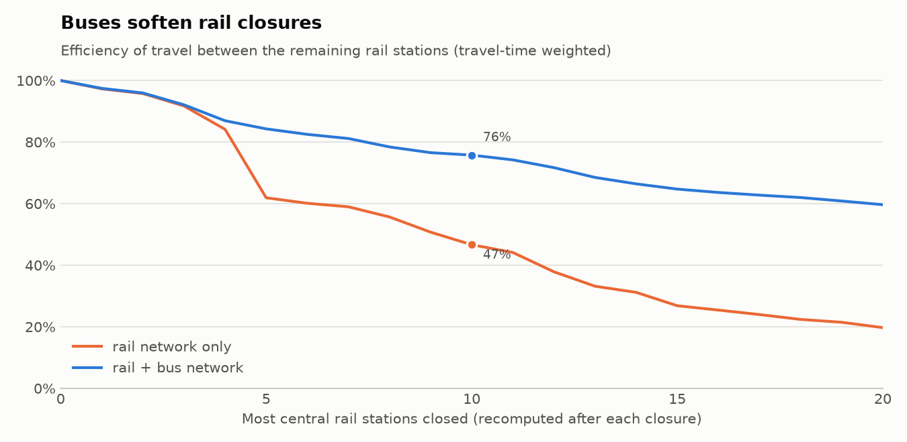
</picture>

### Data for the bus analysis

| Dataset | Contents | Coverage |
|---|---|---|
| [Network Demand: journeys](https://crowding.data.tfl.gov.uk/#!Network%20Demand/) | Total Tube and bus journeys per day | Jan 2019 - Nov 2026 |
| [Network Demand: station footfall](https://crowding.data.tfl.gov.uk/#!Network%20Demand/) | Daily entry and exit taps per rail station | Jan 2019 - Nov 2026 |
| [BUSTO bus demand](https://crowding.data.tfl.gov.uk/#!BUSTO/) | Boardings, alightings, load and capacity for every route, direction and stop by quarter hour, and each stop's busiest hour (typical weekday, Saturday, Sunday) | 2023-24, 2024-25, 2025-26 |
| [TfL bus stops and sequences feeds](https://tfl.gov.uk/info-for/open-data-users/our-open-data) | Stop codes used by BUSTO, stop locations, route sequences | August 2024 |
| [TfL Unified API: bus routes](https://api.tfl.gov.uk/) | 677 current routes with ordered stops | Snapshot at download |

The data is **not stored in git** (BUSTO alone is 3.7 GB). `python-notebooks/data-prep/download_tfl_bus.py`
downloads everything, converts BUSTO to Parquet (580 MB) and deletes the raw CSVs. Every file's source URL,
TfL version, size and checksum is recorded in [`data/bus/manifest.csv`](data/bus/manifest.csv), so anything
deleted can be fetched again; [`data/bus/README.md`](data/bus/README.md) describes the layout and the
quirks found in the data.

## Notes on the data

* The 2014 network is the 2013-era multiplex dataset rather than an official TfL release.
* TfL's annual counts are modelled in 2017 (`Relate`), ticket-gate counts 2018-2023 (`Gateline`) and card
  taps from 2024 (`taps`). Richmond and Wimbledon join the LU series from 2024, and some stations close
  temporarily in some years. Comparisons across years use stations counted in every year.
* BUSTO gives **typical-day averages** for each financial year, not counts for individual days, and starts
  in 2023-24. The bus stop feed dates from August 2024; 0.5% of 2025-26 boardings are at newer stops.
* The combined network and the bus-near-rail measures use **TfL rail only**. National Rail, which serves
  much of south and outer London, is not included.

## Licence

* **Code** (notebooks and Python scripts) is released under the [MIT License](LICENSE).
* **Data keeps its original licences** and is not covered by the MIT License:
  * TfL station counts, NUMBAT link loads, station locations and the bus analysis data (Network Demand,
    BUSTO, bus stop and route data) are © Transport for London, used under the
    [TfL open data terms](https://tfl.gov.uk/info-for/open-data-users/).
    *Powered by TfL Open Data.* Bus stop locations contain OS data © Crown copyright and database rights.
  * The 2014 London multiplex dataset (De Domenico et al., 2014) is licensed under the
    [Open Database License (ODbL)](References/London_Multiplex_Transport/LICENSE_odbl-10.txt),
    with its contents under the
    [Database Contents License (DbCL)](References/London_Multiplex_Transport/LICENSE_dbcl-10.txt).
    Data derived from it, such as the harmonised 2014 network and its results, falls under the same terms.
