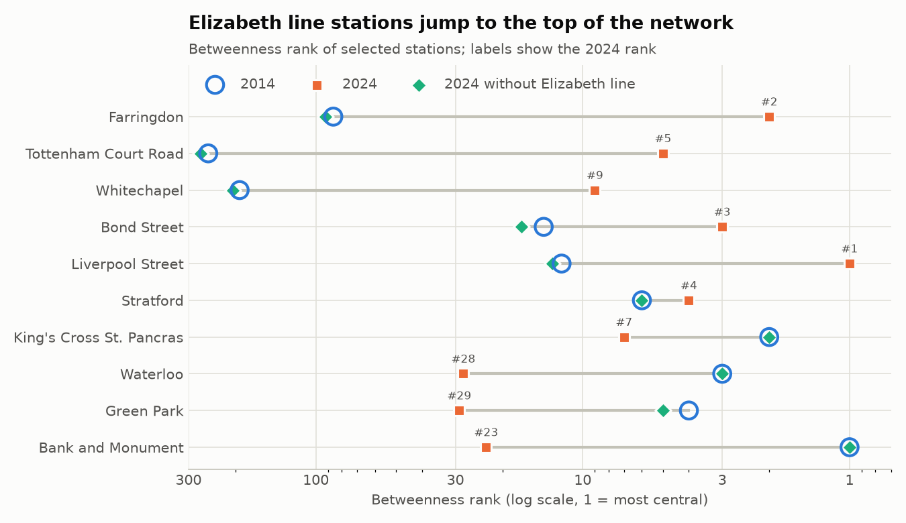
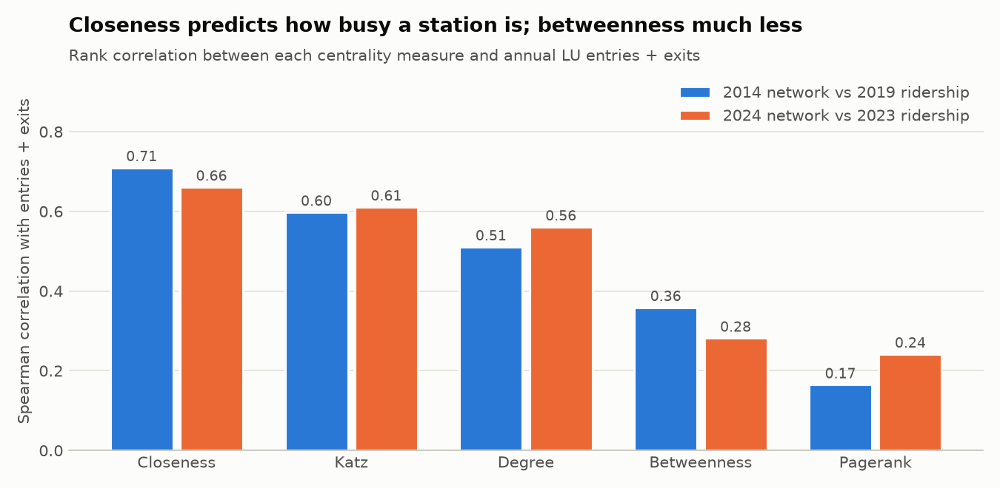

# Analysis of TfL data

Code and data for my MSc Data Analytics dissertation at Queen Mary University of London
(MTHM038, 2023/24): *Analysis of TfL data, with special emphasis on network models*.

The project compares the structure of the London rail network in 2014 and 2024 using five
centrality measures, assesses what the Elizabeth line changed, and studies station
entry/exit counts from 2017 to 2022, including the effect of COVID-19. An
[extended analysis](#extended-analysis) added after submission uses counts up to 2025 to
measure the Elizabeth line's effect on ridership and the network's resilience to closures.
A [TfL bus analysis](#tfl-bus-analysis-coming-soon) is coming soon.

> **Submitted version.** The code exactly as it was when the dissertation was submitted
> (1 September 2024) is preserved at the git tag
> [`dissertation-submitted`](../../tree/dissertation-submitted). The dissertation itself is
> unchanged. Everything after that tag is a post-submission revision of the code and results;
> see [Corrections after submission](#corrections-after-submission).

## Key findings at a glance

* **The Elizabeth line reshaped the network's structure.** Remove it from the 2024 network and 29 of the
  30 top-5 centrality positions return to their 2014 values ([details](#4-corrected-results-2014-vs-2024-network)).
* **It also moved passengers.** Its four new central stations grew about **84% more** than comparable
  central-London stations between 2019 and 2023, roughly 70 million extra entries + exits a year
  ([details](#2-the-elizabeth-lines-effect-on-ridership)).
* **It made the network harder to break.** After the 10 most central stations close, the 2024 network keeps
  49% of its efficiency, against 33-34% without the line ([details](#3-resilience-to-station-closures)).
* **Closeness, not betweenness, predicts how busy a station is** (Spearman rho 0.66-0.71 vs 0.28-0.36)
  ([details](#1-does-centrality-predict-ridership)).

<picture>
  <source media="(prefers-color-scheme: dark)" srcset="figures/centrality-overlap-dark.png">
  
</picture>

<picture>
  <source media="(prefers-color-scheme: dark)" srcset="figures/elizabeth-line-did-dark.png">
  
</picture>

## Repository layout

| Path | Contents |
|---|---|
| `python-notebooks/tfl-2014-centrality.ipynb` | 2014 network (Tube, Overground, DLR) and its centrality measures |
| `python-notebooks/tfl-2024-centrality.ipynb` | 2024 network, its centrality measures, and the like-for-like 2014 vs 2024 comparison |
| `python-notebooks/tfl-passenger-flow.ipynb` | Annual and time-of-day station entry/exit analysis, 2017-2022 |
| `python-notebooks/extended-analysis.ipynb` | Centrality vs ridership, Elizabeth line difference-in-differences, network resilience |
| `python-notebooks/tfl_analysis.py` | Logic shared by the notebooks above |
| `python-notebooks/data-prep/` | How the 2024 network and station coordinates were built, including `fix_station_coordinates.py` |
| `results/` | CSV outputs written by the notebooks |
| `figures/` | README charts, built from `results/` by `python-notebooks/make_readme_figures.py` |
| `data/` | 2024 network edges/stations, TfL station locations and counts (see [`data/README.md`](data/README.md)) |
| `References/London_Multiplex_Transport/` | 2014 network: De Domenico et al. multiplex dataset |
| `python-notebooks/archive/` | Exploratory notebooks from the dissertation period, not used for any result |

## Running

```bash
python -m venv .venv && source .venv/bin/activate
pip install -r requirements.txt
cd python-notebooks
jupyter nbconvert --to notebook --execute --inplace tfl-2014-centrality.ipynb tfl-2024-centrality.ipynb \
    tfl-passenger-flow.ipynb extended-analysis.ipynb
python make_readme_figures.py   # rebuilds the charts in figures/ from results/
python data-prep/fix_station_coordinates.py --refresh   # optional: re-download TfL station locations
```

Each notebook runs top to bottom from a fresh kernel and writes its tables to `results/`.

## Data sources

* **2024 network:** `data/2022-tfl-edges.csv` and `data/tfl_stations_2022_with_coordinates.csv`,
  built for this project from TfL line and station information. Station locations come from the
  [TfL Unified API](https://api.tfl.gov.uk/).
* **2014 network:** the London multiplex transport dataset of M. De Domenico, A. Solé-Ribalta,
  S. Gómez and A. Arenas, *Navigability of interconnected networks under random failures*,
  PNAS 111 (2014) 8351-8356 (licences in `References/London_Multiplex_Transport/`).
* **Passenger counts:** TfL annual station counts (`AnnualisedEntryExit_<year>.xlsx`, 2017-2025) and
  quarter-hourly counts (`ByQhrEntryExit_<year>.xlsx`, 2017-2021), from
  [TfL's crowding data](https://crowding.data.tfl.gov.uk/). *Powered by TfL Open Data.*

## Corrections after submission

### 1. Centrality results reported for 2014

Two of the 2014 top-5 lists in the dissertation (§4.1.1) were copied from the wrong measure:

| Measure | Dissertation | Code output |
|---|---|---|
| Degree | Green Park, Westminster, Bond Street, King's Cross, Oxford Circus *(the closeness list)* | Bank and Monument, Baker Street, King's Cross, Stratford, Canning Town |
| Katz | Oxford Circus, Green Park, Piccadilly Circus, Bond Street, Westminster *(the eigenvector list)* | Bank and Monument, Baker Street, King's Cross, Green Park, Stratford |

In 2014, six stations (Canning Town, Earl's Court, Green Park, Oxford Circus, Waterloo,
West Ham) tie for 5th place on degree with 6 neighbours each, so the last place in the degree
top 5 depends on an arbitrary (alphabetical) tie-break. The notebooks now report ties
(`tied_at_cutoff`).

### 2. One method for the "overall" ranking

The dissertation (Eq. 4.2) defines the overall score as the number of top-5 lists a station
appears in. The 2014 code instead used rank points times appearances / 5, *and used eigenvector
centrality in place of Katz*. The 2024 code used a third rule. Both notebooks now use Eq. 4.2,
with ties broken by summed rank points and then mean percentile (`tfl_analysis.combined_ranking`).

### 3. The two networks are now built the same way

* **Interchanges.** The 2014 data split some station complexes (`bank` / `monument`, three
  `edgwareroad(...)` nodes, two `hammersmith(...)` nodes, two Paddington nodes) that the 2024
  data merges. The 2024 data also listed some DLR platforms separately (`Canary Wharf DLR`,
  `Shadwell DLR`, ...) that the 2014 data merges. Both years now use one node per station
  complex, and 2014 labels are mapped to 2024 names.
* **Trams.** The 2024 graph includes London Trams, which the 2014 data does not have. The
  39-stop tram network is also not connected to the rest of the 2024 graph. The comparison
  below therefore uses 2024 without trams. Removing them changes none of the 2024 top-5 lists.

### 4. Corrected results: 2014 vs 2024 network

| Measure | 2014 | 2024 (no trams) | 2024 without Elizabeth line |
|---|---|---|---|
| Degree | Bank and Monument, Baker Street, King's Cross, Stratford, Canning Town | Stratford, Bank and Monument, Liverpool Street, Baker Street, Canary Wharf | Bank and Monument, Baker Street, King's Cross, Stratford, Canning Town |
| Betweenness | Bank and Monument, King's Cross, Waterloo, Green Park, Euston | Liverpool Street, Farringdon, Bond Street, Stratford, Tottenham Court Road | Bank and Monument, King's Cross, Waterloo, Euston, Green Park |
| Closeness | Green Park, Westminster, King's Cross, Bond Street, Oxford Circus | Farringdon, Liverpool Street, Tottenham Court Road, Bond Street, King's Cross | Green Park, King's Cross, Bank and Monument, Westminster, Oxford Circus |
| Katz | Bank and Monument, Baker Street, King's Cross, Green Park, Stratford | Stratford, Liverpool Street, Bank and Monument, Whitechapel, Canary Wharf | Bank and Monument, Baker Street, King's Cross, Green Park, Stratford |
| PageRank | Stratford, Bank and Monument, King's Cross, Baker Street, Canning Town | Stratford, Bank and Monument, Liverpool Street, King's Cross, Canary Wharf | Stratford, Bank and Monument, King's Cross, Baker Street, Canning Town |
| **Overall** | King's Cross, Bank and Monument, Baker Street, Green Park, Stratford | Liverpool Street, Stratford, Bank and Monument, Canary Wharf, Farringdon | Bank and Monument, King's Cross, Baker Street, Green Park, Stratford |

**Finding.** Removing only the Elizabeth line from the 2024 network restores **29 of the 30**
2014 top-5 positions. With the line included, only 12 of 30 match. The shift in centrality
between 2014 and 2024 is therefore caused almost entirely by the Elizabeth line, not by the
other network changes over the decade. This supports the dissertation's main conclusion more
directly than the original analysis did. Centrality describes network *structure* only, so
it cannot by itself show changes in passenger flow or the effect of local development.

Betweenness rank (1 = highest) of selected stations:

| Station | 2014 | 2024 | 2024 without Elizabeth line |
|---|---|---|---|
| Farringdon | 86 | 2 | 92 |
| Tottenham Court Road | 253 | 5 | 270 |
| Whitechapel | 193 | 9 | 204 |
| Liverpool Street | 12 | 1 | 13 |
| Bank and Monument | 1 | 23 | 1 |
| Green Park | 4 | 29 | 5 |

<picture>
  <source media="(prefers-color-scheme: dark)" srcset="figures/betweenness-ranks-dark.png">
  
</picture>

Full tables: `results/centrality_top5_comparison.csv`, `results/betweenness_rank_key_stations.csv`.

### 5. Passenger counts comparable across years

The submitted code added LU station entry/exit counts to Overground, DLR and TfL Rail
*boarding/alighting* counts. It dropped TfL Rail rows for 2017-2019 but kept the same service
(listed as `EZL`) for 2020-2022. Also, from 2022, TfL folds shared-station passengers into
the LU gate count (`---see LU---` rows). Totals and rankings therefore were not comparable
between years. All passenger figures now use **LU station entry/exit gate counts only**:
the one series published on the same basis for 2017-2022 (264-266 stations per year).

| Year | 2017 | 2018 | 2019 | 2020 | 2021 | 2022 |
|---|---|---|---|---|---|---|
| LU entries + exits (bn) | 2.776 | 2.748 | 2.843 | 1.015 | 1.168 | 2.147 |

<picture>
  <source media="(prefers-color-scheme: dark)" srcset="figures/lu-totals-dark.png">
  
</picture>

Top stations change accordingly. Before COVID they were King's Cross St. Pancras, Victoria,
Waterloo, Oxford Circus and London Bridge. Stratford tops only 2020 (25.1M), and Canning Town
is not in any year's top 5 (`results/top5_stations_by_year.csv`).

**Farringdon vs Green Park.** The whole LU network fell 22.7% between 2017 and 2022. Measured
as a share of all LU traffic:

| Station | 2017 | 2022 | Raw change | Change relative to network |
|---|---|---|---|---|
| Farringdon | 19.3M | 30.1M | +55.6% | **+101%** (share 0.70% → 1.40%) |
| Tottenham Court Road | 39.2M | 49.0M | +24.9% | +62% |
| Whitechapel | 13.1M | 14.3M | +8.6% | +40% |
| Bond Street | 36.9M | 35.4M | −3.9% | +24% |
| Green Park | 37.4M | 28.4M | −24.0% | −2% |

Green Park's fall matches the network-wide post-COVID drop, so it does not show Green Park
becoming less central. The Elizabeth line stations, by contrast, roughly doubled
(Farringdon) or substantially grew their share of traffic. Bank and Monument's 2022 figure
(−25% relative to the network) is also affected by the 2022 Bank station closure works.

<picture>
  <source media="(prefers-color-scheme: dark)" srcset="figures/station-share-change-dark.png">
  
</picture>

**Time of day.** On LU weekdays, the AM peak share fell from 25.8% (2019) to 23.4% (2021)
while inter-peak rose from 25.8% to 27.1% (`results/lu_typical_day_profile.csv`). 2017 is
published as a Monday-Friday profile and 2018 onwards as Monday-Thursday.

<picture>
  <source media="(prefers-color-scheme: dark)" srcset="figures/weekday-profile-dark.png">
  
</picture>

### 6. Other code fixes

* The passenger-flow notebook had a cell that raised `KeyError` and had been run out of order.
  All three notebooks now run top to bottom from a fresh kernel.
* The 2024 notebook relied on a global graph `G` that was emptied and re-filled between cells.
  It now builds graphs explicitly.

### 7. Station coordinates

The coordinates in `data/tfl_stations_2022_with_coordinates.csv` were originally geocoded by name with
the Google Maps API, and **76 stations were more than 1 km out**. Queensbury resolved to New York State,
and whole stretches of the District, Central and tram lines were displaced. Every station now takes its
location from TfL's own Unified API, matched by name *and* mode (`python-notebooks/data-prep/fix_station_coordinates.py`;
every change is logged in `data/coordinate-fixes.csv`).

Checked against the independent 2014 dataset, all 364 shared stations are now within 419 m (median 35 m),
down from 55 stations more than 1 km off. No earlier result depended on these coordinates: the network
analysis uses station connections only. The extended analysis uses them to define the control group.

<picture>
  <source media="(prefers-color-scheme: dark)" srcset="figures/network-map-dark.png">
  
</picture>

## Extended analysis

Added after submission; see [`python-notebooks/extended-analysis.ipynb`](python-notebooks/extended-analysis.ipynb).
It uses TfL station counts up to **2025**. TfL changed how it counts twice: modelled estimates in 2017,
ticket-gate counts 2018-2023, and card taps from 2024. The main comparisons therefore use **2019 vs 2023**,
both gate counts.

### 1. Does centrality predict ridership?

Spearman rank correlation between each centrality measure and annual LU entries + exits (263-264 stations):

| Measure | 2014 network vs 2019 ridership | 2024 network vs 2023 ridership |
|---|---|---|
| Closeness | 0.71 | 0.66 |
| Katz | 0.60 | 0.61 |
| Degree | 0.51 | 0.56 |
| Betweenness | 0.36 | 0.28 |
| PageRank | 0.17 | 0.24 |

<picture>
  <source media="(prefers-color-scheme: dark)" srcset="figures/centrality-vs-ridership-dark.png">
  
</picture>

Closeness (how few stops a station is from everywhere else) is the best predictor of how busy a station is.
Betweenness, the measure the dissertation relied on most, is much weaker. Being on many shortest routes says
more about interchange load inside the network than about how many people start or end journeys at a station.

### 2. The Elizabeth line's effect on ridership

A **difference-in-differences** design compares how much station traffic changed at Elizabeth line stations
with how much it changed at similar stations without the line.

* **Treated:** the four new central stations whose Elizabeth line passengers pass through the LU ticket gates
  (TfL marks them `---see LU---`): Bond Street, Tottenham Court Road, Farringdon, Whitechapel.
* **Control:** the 56 other LU stations within 4 km of them, so both groups shared central London's slow
  post-COVID recovery. A version with every other LU station is shown for comparison.
* Paddington and Liverpool Street are reported separately: the earlier TfL Rail service was counted
  separately there until 2022. Stratford and Ealing Broadway are excluded, because TfL Rail already served them.

| | 2019 → 2023 |
|---|---|
| Extra growth at the four stations vs control | **+84%** (95% CI +56% to +117%) |
| Placebo test: 10,000 random groups of four control stations | none as large; largest +27%, p = 0.0001 |
| Extra entries + exits in 2023 at the four stations | about 70 million |

The year-by-year chart under [Key findings](#key-findings-at-a-glance) shows the treated and control stations
moving together before the line opened (2018: −1%; 2020-21 within 6%). The effect appears in 2022, the year it
opened, and holds through 2025 (+94%). 2017 sits lower (−8%), but 2017 counts are modelled rather than gate
counts, and Farringdon's 2018 jump coincides with the Thameslink upgrade.

| Station | 2019 | 2023 | 2025 | vs control, 2019 → 2023 |
|---|---|---|---|---|
| Farringdon | 25.9M | 40.1M | 42.0M | +118% |
| Tottenham Court Road | 42.0M | 58.7M | 60.8M | +97% |
| Whitechapel | 13.1M | 17.5M | 17.9M | +88% |
| Bond Street | 37.5M | 37.4M | 42.3M | +41% |
| *Paddington* | 48.6M | 48.5M | 58.0M | *+41%* |
| *Liverpool Street* | 67.2M | 57.2M | 60.1M | *+20%* |
| *Canary Wharf (LU station)* | 47.7M | 30.9M | 32.6M | *−9%* |

This measures traffic *through these stations*, including passengers who switched from nearby stations. It
is not an estimate of new journeys across the whole network. Canary Wharf's Underground station lost ground
as passengers moved to the separate Elizabeth line station next door.

### 3. Resilience to station closures

**Network efficiency** is the average of 1 / (number of stops) over all pairs of stations: it falls as
stations close, and it stays meaningful when the network splits into pieces.

<picture>
  <source media="(prefers-color-scheme: dark)" srcset="figures/resilience-dark.png">
  
</picture>

* **Targeted closures:** close the most central station (highest betweenness, recomputed after each
  closure). After 10 closures, the 2024 network keeps **49%** of its efficiency, against **33%** in 2014 and
  **34%** for 2024 without the Elizabeth line. The line adds a second east-west trunk, so traffic has another
  way across London. The advantage disappears by about 20 closures, when every version is badly fragmented.
* **Random closures** are much less damaging: about 9% of efficiency lost after 10, and about a third after 40,
  in every version.
* **The flip side is concentration at Stratford.** It is the single most damaging closure in 2024 (12.3% of
  efficiency lost, up from 9.0% in 2014). Euston, Camden Town, Leyton and Leytonstone follow, the last two
  because the Central line's Epping and Hainault branches depend on them.

Full outputs: `results/centrality_vs_ridership.csv`, `results/elizabeth_line_*.csv`, `results/resilience_*.csv`.

## TfL bus analysis (coming soon)

> 🚧 **In progress.** The next part of this project extends the analysis from rail to London's
> bus network. TfL publishes the data openly, so everything below is reproducible.

### Planned analyses

1. **Bus vs Tube recovery after COVID.** Daily journey counts for both modes, 2019-2026: how each
   recovered, how weekday and weekend travel differ, and whether bus use changed along the
   Elizabeth line corridor after it opened.
2. **Daily before/after for the Elizabeth line.** Re-estimate the [ridership effect](#2-the-elizabeth-lines-effect-on-ridership)
   from daily station footfall around the opening on 24 May 2022, instead of annual counts.
3. **Bus crowding.** The most crowded routes and stops by time of day, and whether they cluster around
   rail stations or in areas the Underground does not reach.
4. **A combined bus + rail network.** Build the bus network from TfL's route and stop sequences, link it
   to the rail stations, and re-run the centrality and resilience analysis on the combined network:
   which stations matter most once buses are counted, and which areas depend on a single route.

### Data

| Dataset | Contents | Coverage | Size |
|---|---|---|---|
| [Network Demand: journeys](https://crowding.data.tfl.gov.uk/#!Network%20Demand/) (`Journeys_*.csv`) | Total Tube and bus journeys per day | 2019 - 2026 | < 30 KB per year |
| [Network Demand: station footfall](https://crowding.data.tfl.gov.uk/#!Network%20Demand/) (`StationFootfall_*.csv`) | Daily entries and exits per rail station | 2019 - 2026 | 6-13 MB per year |
| [BUSTO bus demand](https://crowding.data.tfl.gov.uk/#!BUSTO/) | Boardings, alightings, on-board load, capacity and crowding ratio for every route, direction and stop, by quarter hour (weekday, Saturday, Sunday) | 2023-24, 2024-25, 2025-26 | about 1.2-1.3 GB per year (13 files) |
| [TfL Unified API: bus routes](https://api.tfl.gov.uk/Line/Mode/bus) | All 677 bus routes, with ordered stop sequences and stop coordinates | Current | Small |

The BUSTO files are each up to about 120 MB, above GitHub's 100 MB file limit, so they will not be
stored in this repository. A download script will fetch them locally, and only summarised results
will be committed.

## Notes on the data

* The 2014 network is the 2013-era multiplex dataset rather than an official TfL release.
* TfL's annual counts are modelled in 2017 (`Relate`), ticket-gate counts 2018-2023 (`Gateline`) and card
  taps from 2024 (`taps`). Richmond and Wimbledon join the LU series from 2024, and some stations close
  temporarily in some years. Comparisons across years use stations counted in every year.
