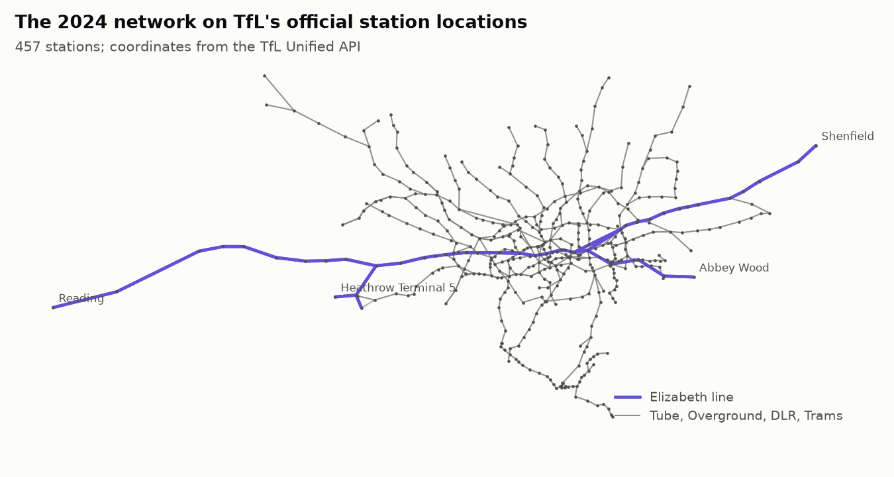

# Corrections after submission

The dissertation (submitted 1 September 2024) is unchanged. The code exactly as it was when the dissertation
was submitted is preserved at the git tag
[`dissertation-submitted`](https://github.com/AimanxxAnsari/analysis-of-tfl-data/tree/dissertation-submitted).
Everything after that tag is a post-submission revision of the code and results. This page lists what was
corrected and links to the corrected results.

[← Back to the README](../README.md)

## Centrality results reported for 2014

Two of the 2014 top-5 lists in the dissertation (§4.1.1) were copied from the wrong measure:

| Measure | Dissertation | Code output |
|---|---|---|
| Degree | Green Park, Westminster, Bond Street, King's Cross, Oxford Circus *(the closeness list)* | Bank and Monument, Baker Street, King's Cross, Stratford, Canning Town |
| Katz | Oxford Circus, Green Park, Piccadilly Circus, Bond Street, Westminster *(the eigenvector list)* | Bank and Monument, Baker Street, King's Cross, Green Park, Stratford |

In 2014, six stations (Canning Town, Earl's Court, Green Park, Oxford Circus, Waterloo,
West Ham) tie for 5th place on degree with 6 neighbours each, so the last place in the degree
top 5 depends on an arbitrary (alphabetical) tie-break. The notebooks now report ties
(`tied_at_cutoff`).

Corrected results: [Network structure: 2014 vs 2024](network.md#network-structure-2014-vs-2024).

## One method for the "overall" ranking

The dissertation (Eq. 4.2) defines the overall score as the number of top-5 lists a station
appears in. The 2014 code instead used rank points times appearances / 5, *and used eigenvector
centrality in place of Katz*. The 2024 code used a third rule. Both notebooks now use Eq. 4.2,
with ties broken by summed rank points and then mean percentile (`tfl_analysis.combined_ranking`).

## The two networks are now built the same way

* **Interchanges.** The 2014 data split some station complexes (`bank` / `monument`, three
  `edgwareroad(...)` nodes, two `hammersmith(...)` nodes, two Paddington nodes) that the 2024
  data merges. The 2024 data also listed some DLR platforms separately (`Canary Wharf DLR`,
  `Shadwell DLR`, ...) that the 2014 data merges. Both years now use one node per station
  complex, and 2014 labels are mapped to 2024 names.
* **Trams.** The 2024 graph includes London Trams, which the 2014 data does not have. The
  39-stop tram network is also not connected to the rest of the 2024 graph. The comparison
  therefore uses 2024 without trams. Removing them changes none of the 2024 top-5 lists.

## Passenger counts comparable across years

The submitted code added LU station entry/exit counts to Overground, DLR and TfL Rail
*boarding/alighting* counts. It dropped TfL Rail rows for 2017-2019 but kept the same service
(listed as `EZL`) for 2020-2022. Also, from 2022, TfL folds shared-station passengers into
the LU gate count (`---see LU---` rows). Totals and rankings therefore were not comparable
between years. All passenger figures now use **LU station entry/exit gate counts only**:
the one series published on the same basis for 2017-2022 (264-266 stations per year).

Corrected results: [Underground passengers, 2017-2022](passengers-and-buses.md#underground-passengers-2017-2022)
and [Farringdon vs Green Park](elizabeth-line.md#early-signs-in-the-2017-2022-counts).

## Other code fixes

* The passenger-flow notebook had a cell that raised `KeyError` and had been run out of order.
  All three notebooks now run top to bottom from a fresh kernel.
* The 2024 notebook relied on a global graph `G` that was emptied and re-filled between cells.
  It now builds graphs explicitly.

## Station coordinates

The coordinates in `data/tfl_stations_2022_with_coordinates.csv` were originally geocoded by name with
the Google Maps API, and **76 stations were more than 1 km out**. Queensbury resolved to New York State,
and whole stretches of the District, Central and tram lines were displaced. Every station now takes its
location from TfL's own Unified API, matched by name *and* mode (`python-notebooks/data-prep/fix_station_coordinates.py`;
every change is logged in `data/coordinate-fixes.csv`).

Checked against the independent 2014 dataset, all 364 shared stations are now within 419 m (median 35 m),
down from 55 stations more than 1 km off. No earlier result depended on these coordinates: the network
analysis uses station connections only. The extended analysis uses them to define the control group.

<picture>
  <source media="(prefers-color-scheme: dark)" srcset="../figures/network-map-dark.png">
  
</picture>
