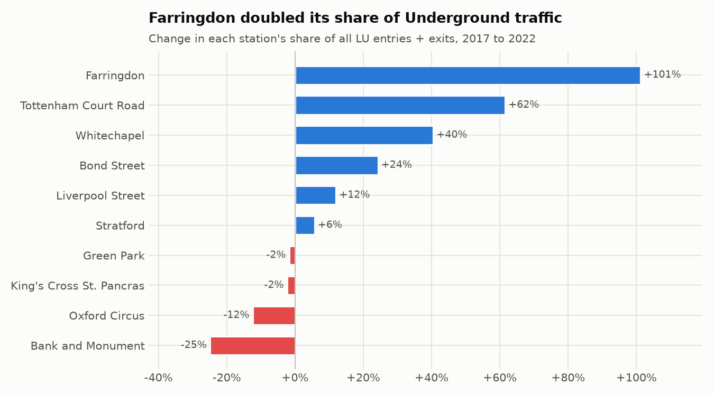
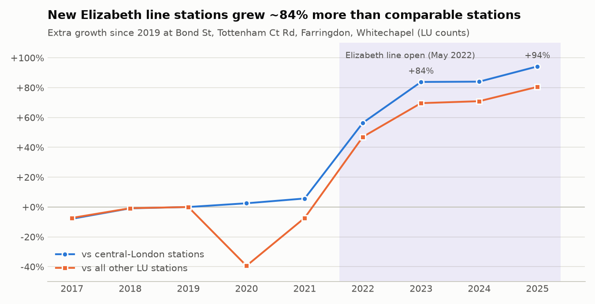
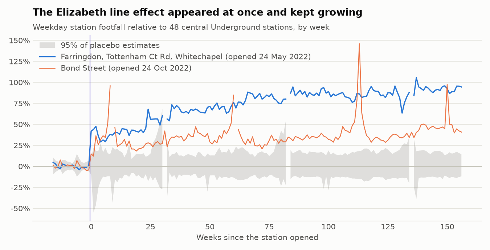
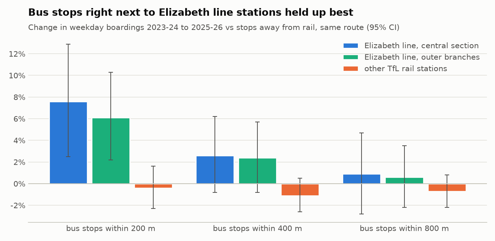

# The Elizabeth line

What the Elizabeth line changed: the network's structure, traffic at its new central stations (from
annual counts and from daily data), and bus demand around its stations.

[← Back to the README](../README.md)

Notebooks: [`extended-analysis.ipynb`](../python-notebooks/extended-analysis.ipynb),
[`elizabeth-line-daily.ipynb`](../python-notebooks/elizabeth-line-daily.ipynb),
[`bus-demand-change.ipynb`](../python-notebooks/bus-demand-change.ipynb),
[`tfl-passenger-flow.ipynb`](../python-notebooks/tfl-passenger-flow.ipynb).

## The network's structure

Removing only the Elizabeth line from the 2024 network restores **29 of the 30**
2014 top-5 positions. With the line included, only 12 of 30 match. Details:
[Network structure: 2014 vs 2024](network.md#network-structure-2014-vs-2024). The line also makes the network
harder to break: see [resilience to station closures](network.md#resilience-to-station-closures).

## Early signs in the 2017-2022 counts

**Farringdon vs Green Park.** The whole LU network fell 22.7% between 2017 and 2022. Measured
as a share of all LU traffic:

| Station | 2017 | 2022 | Raw change | Change relative to network |
|---|---|---|---|---|
| Farringdon | 19.3M | 30.1M | +55.6% | **+101%** (share 0.70% → 1.40%) |
| Tottenham Court Road | 39.2M | 49.0M | +24.9% | +62% |
| Whitechapel | 13.1M | 14.3M | +8.6% | +40% |
| Bond Street | 36.9M | 35.4M | −3.9% | +24% |
| Green Park | 37.4M | 28.4M | −24.0% | −2% |

Green Park's fall matches the network-wide post-COVID drop, so it does not show Green Park
becoming less central. The Elizabeth line stations, by contrast, roughly doubled
(Farringdon) or substantially grew their share of traffic. Bank and Monument's 2022 figure
(−25% relative to the network) is also affected by the 2022 Bank station closure works.

<picture>
  <source media="(prefers-color-scheme: dark)" srcset="../figures/station-share-change-dark.png">
  
</picture>

## Effect on ridership: annual counts

This uses TfL station counts up to **2025**. TfL changed how it counts twice: modelled estimates in 2017,
ticket-gate counts 2018-2023, and card taps from 2024. The main comparisons therefore use **2019 vs 2023**,
both gate counts.

A **difference-in-differences** design compares how much station traffic changed at Elizabeth line stations
with how much it changed at similar stations without the line.

* **Treated:** the four new central stations whose Elizabeth line passengers pass through the LU ticket gates
  (TfL marks them `---see LU---`): Bond Street, Tottenham Court Road, Farringdon, Whitechapel.
* **Control:** the 56 other LU stations within 4 km of them, so both groups shared central London's slow
  post-COVID recovery. A version with every other LU station is shown for comparison.
* Paddington and Liverpool Street are reported separately: the earlier TfL Rail service was counted
  separately there until 2022. Stratford and Ealing Broadway are excluded, because TfL Rail already served them.

| | 2019 → 2023 |
|---|---|
| Extra growth at the four stations vs control | **+84%** (95% CI +56% to +117%) |
| Placebo test: 10,000 random groups of four control stations | none as large; largest +27%, p = 0.0001 |
| Extra entries + exits in 2023 at the four stations | about 70 million |

<picture>
  <source media="(prefers-color-scheme: dark)" srcset="../figures/elizabeth-line-did-dark.png">
  
</picture>

The year-by-year chart above shows the treated and control stations
moving together before the line opened (2018: −1%; 2020-21 within 6%). The effect appears in 2022, the year it
opened, and holds through 2025 (+94%). 2017 sits lower (−8%), but 2017 counts are modelled rather than gate
counts, and Farringdon's 2018 jump coincides with the Thameslink upgrade.

| Station | 2019 | 2023 | 2025 | vs control, 2019 → 2023 |
|---|---|---|---|---|
| Farringdon | 25.9M | 40.1M | 42.0M | +118% |
| Tottenham Court Road | 42.0M | 58.7M | 60.8M | +97% |
| Whitechapel | 13.1M | 17.5M | 17.9M | +88% |
| Bond Street | 37.5M | 37.4M | 42.3M | +41% |
| *Paddington* | 48.6M | 48.5M | 58.0M | *+41%* |
| *Liverpool Street* | 67.2M | 57.2M | 60.1M | *+20%* |
| *Canary Wharf (LU station)* | 47.7M | 30.9M | 32.6M | *−9%* |

This measures traffic *through these stations*, including passengers who switched from nearby stations. It
is not an estimate of new journeys across the whole network. Canary Wharf's Underground station lost ground
as passengers moved to the separate Elizabeth line station next door.

Full outputs: `results/elizabeth_line_*.csv`.

## Effect on ridership: daily station data

The annual analysis above found the four new central stations
grew about 84% more than nearby stations between 2019 and 2023. Daily station footfall (entry + exit
taps, weekdays, strikes and holidays removed) shows when that happened. Each station is compared with
48 central Underground stations, relative to its own 16 weeks before opening.

<picture>
  <source media="(prefers-color-scheme: dark)" srcset="../figures/elizabeth-line-daily-dark.png">
  
</picture>

| After opening | Farringdon, Tottenham Court Road, Whitechapel (24 May 2022) | Bond Street (24 Oct 2022) |
|---|---|---|
| 16 weeks before | 0.0% | +0.1% |
| first 4 weeks | **+42%** | +22% |
| weeks 27-52 | +65% | +34% |
| year 2 | +82% | +34% |
| year 3 | **+88%** | +44% |

* **The effect was immediate**, with no movement before opening, and grew in steps with through services
  (November 2022) and the full timetable (May 2023). By station, year 3: Farringdon +130%, Tottenham
  Court Road +95%, Whitechapel +47%, Bond Street +44%.
* **It is not chance.** In an exact placebo test, no set of control stations comes close: p = 0.0001 over
  all 17,296 sets for the central three, and p = 0.02, the smallest possible with 48 placebos, for Bond
  Street. (Bond Street's December spikes are West End Christmas shopping.)
* **It matches the annual analysis:** 2019 to 2023 gives +73% from daily weekday taps vs +84% from annual
  counts, and 2019 to 2025 +91% vs +94%.
* **Part of it is passengers moving from nearby stations,** which fell 4-9% relative to stations further
  away. Comparing only with stations more than 1 km away gives +82% in year 3 instead of +88%.
* The Northern line Bank branch (Kennington to Angel) is left out of the control group: it was closed
  from January to May 2022, exactly the period before the opening.

Full outputs: `results/bus/elizabeth_line_daily_*.csv`.

## Bus demand near the line

BUSTO bus demand starts in 2023-24, after the Elizabeth line opened, so it cannot give a before/after
for buses. It can show where bus demand changed since then (see
[where bus demand fell](passengers-and-buses.md#where-bus-demand-fell)).

* **Near the Elizabeth line, demand held up slightly better, mostly at the stations' doorstep.** The raw
  gap (-1.5% near the line vs -7.1% elsewhere) is mostly geography and new routes. Comparing stops on the
  same route, with distance from the centre and capacity changes controlled for, stops near the line did
  about 2-3% better than stops away from rail at 400 m (not significant), but **7.6% better within 200 m**
  of a central-section station (95% CI +2.5% to +12.9%). Stops near other TfL rail stations did no better.

<picture>
  <source media="(prefers-color-scheme: dark)" srcset="../figures/bus-change-near-elizabeth-line-dark.png">
  
</picture>

Full outputs: `results/bus/bus_change_near_el_*.csv`.
