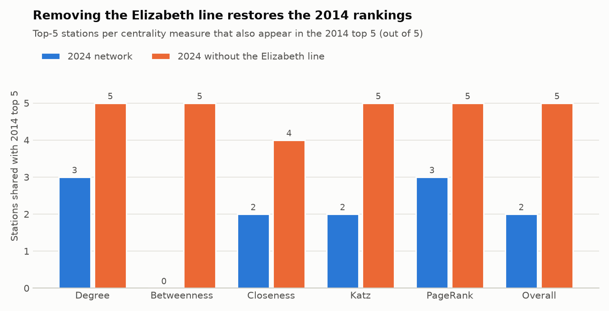
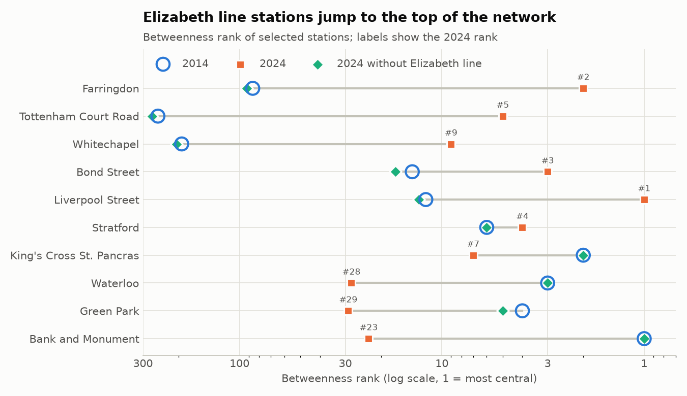
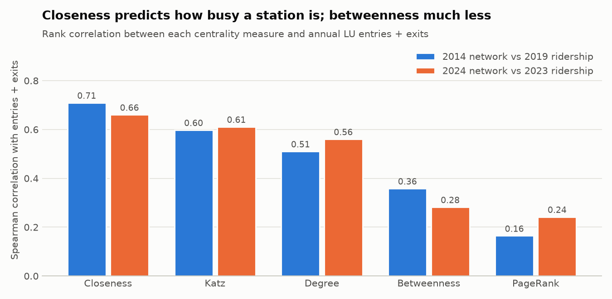
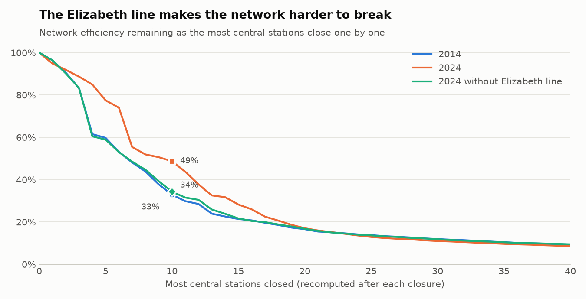
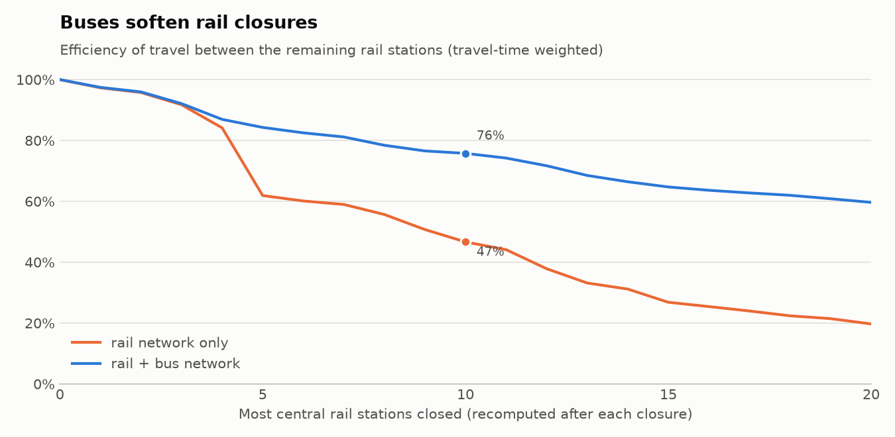

# Network structure and resilience

How the London rail network changed between 2014 and 2024, which stations are most central, how
centrality relates to ridership, how the network copes with closures, and what changes when buses
are added.

[← Back to the README](../README.md)

Notebooks: [`tfl-2014-centrality.ipynb`](../python-notebooks/tfl-2014-centrality.ipynb),
[`tfl-2024-centrality.ipynb`](../python-notebooks/tfl-2024-centrality.ipynb),
[`extended-analysis.ipynb`](../python-notebooks/extended-analysis.ipynb),
[`bus-rail-network.ipynb`](../python-notebooks/bus-rail-network.ipynb).

## Network structure: 2014 vs 2024

Both networks are built the same way: one node per station complex, and 2024 without trams
(see [corrections](corrections.md#the-two-networks-are-now-built-the-same-way)).

| Measure | 2014 | 2024 (no trams) | 2024 without Elizabeth line |
|---|---|---|---|
| Degree | Bank and Monument, Baker Street, King's Cross, Stratford, Canning Town | Stratford, Bank and Monument, Liverpool Street, Baker Street, Canary Wharf | Bank and Monument, Baker Street, King's Cross, Stratford, Canning Town |
| Betweenness | Bank and Monument, King's Cross, Waterloo, Green Park, Euston | Liverpool Street, Farringdon, Bond Street, Stratford, Tottenham Court Road | Bank and Monument, King's Cross, Waterloo, Euston, Green Park |
| Closeness | Green Park, Westminster, King's Cross, Bond Street, Oxford Circus | Farringdon, Liverpool Street, Tottenham Court Road, Bond Street, King's Cross | Green Park, King's Cross, Bank and Monument, Westminster, Oxford Circus |
| Katz | Bank and Monument, Baker Street, King's Cross, Green Park, Stratford | Stratford, Liverpool Street, Bank and Monument, Whitechapel, Canary Wharf | Bank and Monument, Baker Street, King's Cross, Green Park, Stratford |
| PageRank | Stratford, Bank and Monument, King's Cross, Baker Street, Canning Town | Stratford, Bank and Monument, Liverpool Street, King's Cross, Canary Wharf | Stratford, Bank and Monument, King's Cross, Baker Street, Canning Town |
| **Overall** | King's Cross, Bank and Monument, Baker Street, Green Park, Stratford | Liverpool Street, Stratford, Bank and Monument, Canary Wharf, Farringdon | Bank and Monument, King's Cross, Baker Street, Green Park, Stratford |

**Finding.** Removing only the Elizabeth line from the 2024 network restores **29 of the 30**
2014 top-5 positions. With the line included, only 12 of 30 match. The shift in centrality
between 2014 and 2024 is therefore caused almost entirely by the Elizabeth line, not by the
other network changes over the decade. This supports the dissertation's main conclusion more
directly than the original analysis did. Centrality describes network *structure* only, so
it cannot by itself show changes in passenger flow or the effect of local development.

<picture>
  <source media="(prefers-color-scheme: dark)" srcset="../figures/centrality-overlap-dark.png">
  
</picture>

Betweenness rank (1 = highest) of selected stations:

| Station | 2014 | 2024 | 2024 without Elizabeth line |
|---|---|---|---|
| Farringdon | 86 | 2 | 92 |
| Tottenham Court Road | 253 | 5 | 270 |
| Whitechapel | 193 | 9 | 204 |
| Liverpool Street | 12 | 1 | 13 |
| Bank and Monument | 1 | 23 | 1 |
| Green Park | 4 | 29 | 5 |

<picture>
  <source media="(prefers-color-scheme: dark)" srcset="../figures/betweenness-ranks-dark.png">
  
</picture>

Full tables: `results/centrality_top5_comparison.csv`, `results/betweenness_rank_key_stations.csv`.

## Does centrality predict ridership?

Spearman rank correlation between each centrality measure and annual LU entries + exits (263-264 stations):

| Measure | 2014 network vs 2019 ridership | 2024 network vs 2023 ridership |
|---|---|---|
| Closeness | 0.71 | 0.66 |
| Katz | 0.60 | 0.61 |
| Degree | 0.51 | 0.56 |
| Betweenness | 0.36 | 0.28 |
| PageRank | 0.16 | 0.24 |

<picture>
  <source media="(prefers-color-scheme: dark)" srcset="../figures/centrality-vs-ridership-dark.png">
  
</picture>

Closeness (how few stops a station is from everywhere else) is the best predictor of how busy a station is.
Betweenness, the measure the dissertation relied on most, is much weaker. Being on many shortest routes says
more about interchange load inside the network than about how many people start or end journeys at a station.

Full outputs: `results/centrality_vs_ridership.csv`.

## Resilience to station closures

**Network efficiency** is the average of 1 / (number of stops) over all pairs of stations: it falls as
stations close, and it stays meaningful when the network splits into pieces.

<picture>
  <source media="(prefers-color-scheme: dark)" srcset="../figures/resilience-dark.png">
  
</picture>

* **Targeted closures:** close the most central station (highest betweenness, recomputed after each
  closure). After 10 closures, the 2024 network keeps **49%** of its efficiency, against **33%** in 2014 and
  **34%** for 2024 without the Elizabeth line. The line adds a second east-west trunk, so traffic has another
  way across London. The advantage disappears by about 20 closures, when every version is badly fragmented.
* **Random closures** are much less damaging: about 9% of efficiency lost after 10, and about a third after 40,
  in every version.
* **The flip side is concentration at Stratford.** It is the single most damaging closure in 2024 (12.3% of
  efficiency lost, up from 9.0% in 2014). Euston, Camden Town, Leyton and Leytonstone follow, the last two
  because the Central line's Epping and Hainault branches depend on them.

Full outputs: `results/resilience_*.csv`.

## A combined bus + rail network

10,273 bus stop areas (stops on both sides of the road) and 418 rail stations, joined by 2,446 walking
links (up to 400 m). Edges are weighted by estimated travel time: bus 15 km/h on road distance, rail
30 km/h, walking 4.8 km/h plus 5 minutes to change mode. There is no timetable, so travel times are
best read as relative. "Rail" means TfL rail (Underground, Overground, DLR, Elizabeth line; no trams,
no National Rail).

* **Rail cuts average journey times by about a third:** 79 minutes from a typical stop area to all others
  with rail, 116 by bus alone. Rail saves most in outer London (45 min) and least in south London, where
  TfL rail is sparse.
* **Buses change which rail stations matter most** (Spearman 0.74 with the rail-only ranking). The top
  stations are those where large bus catchments meet fast rail: Canada Water, London Bridge, Surrey Quays,
  Earl's Court, Liverpool Street, Bank and Monument. Bus interchanges at the edge of the rail network rise
  sharply (West Croydon, Norwood Junction, Woolwich, Abbey Wood); stations beyond the bus network fall.
  *Caveat:* without National Rail, the Overground through south-east London is the only fast route there
  in the model, which lifts its stations (New Cross Gate, Brockley, Forest Hill) by 100-160 places.
* **Buses soften rail closures.** After the 10 most central rail stations close, travel between the
  remaining stations keeps 47% of its efficiency on rail alone but 76% with buses.
* **Local dependence on single routes.** No one bus route matters for the network as a whole (at most 1%
  of efficiency), but 388 of 606 routes are the only link for at least one stop area, and 37% of stop
  areas are served by one route: 21% within 400 m of rail, 47% more than 2 km away.
* Rankings are stable for bus speeds of 12-18 km/h, rail 25 km/h, change penalties of 2-10 minutes and
  200 m walking links (Spearman 0.97-1.00).

<picture>
  <source media="(prefers-color-scheme: dark)" srcset="../figures/bus-rail-closures-dark.png">
  
</picture>

Full outputs: `results/bus/network_*.csv`.
