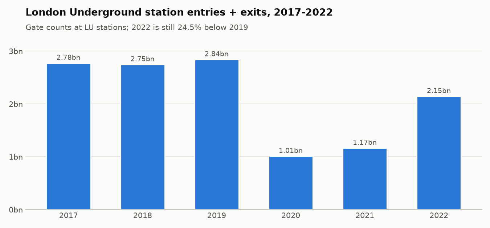
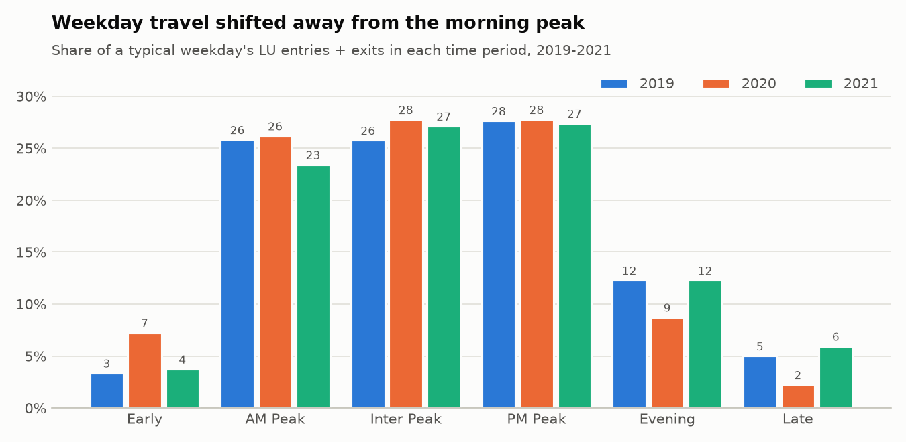
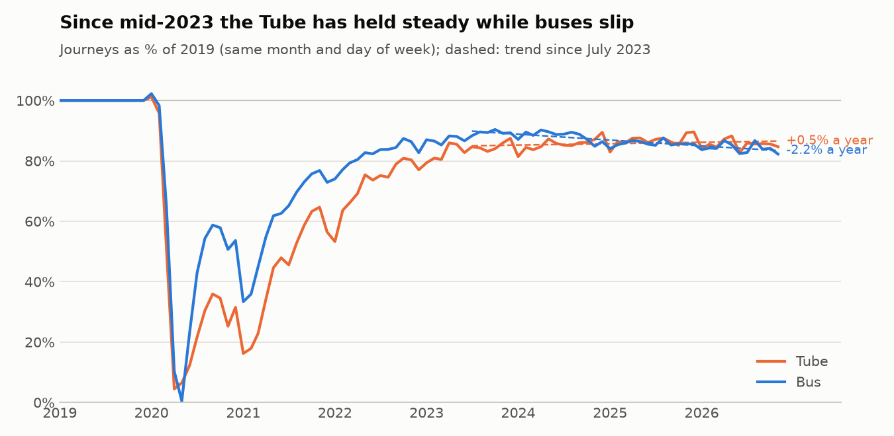
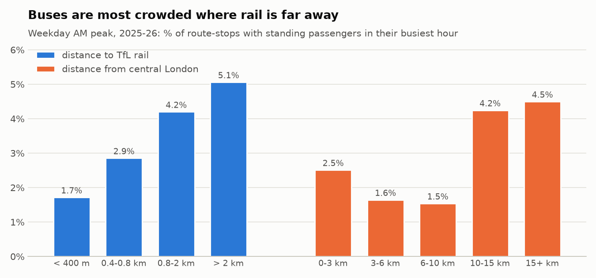
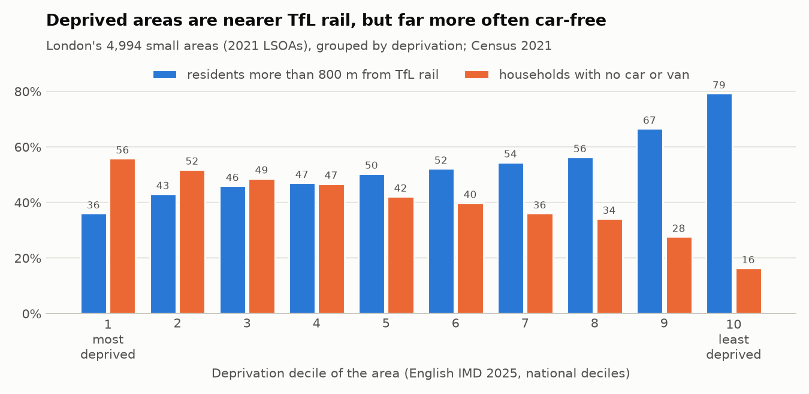

# Passengers and buses

Underground passenger counts 2017-2022, bus and Tube recovery after COVID, where bus demand fell
since 2023-24, bus crowding, and who depends on buses.

[← Back to the README](../README.md)

Notebooks: [`tfl-passenger-flow.ipynb`](../python-notebooks/tfl-passenger-flow.ipynb),
[`bus-tube-recovery.ipynb`](../python-notebooks/bus-tube-recovery.ipynb),
[`bus-demand-change.ipynb`](../python-notebooks/bus-demand-change.ipynb),
[`bus-crowding.ipynb`](../python-notebooks/bus-crowding.ipynb),
[`bus-who-depends.ipynb`](../python-notebooks/bus-who-depends.ipynb); groundwork in
[`bus-routes-stops.ipynb`](../python-notebooks/bus-routes-stops.ipynb) and
[`bus-eda.ipynb`](../python-notebooks/bus-eda.ipynb).

"Rail" means TfL rail throughout (Underground, Overground, DLR, Elizabeth line; no trams, no National Rail).

## Underground passengers, 2017-2022

All passenger figures use **LU station entry/exit gate counts only**: the one series published on the same
basis for 2017-2022 (264-266 stations per year; see
[corrections](corrections.md#passenger-counts-comparable-across-years)).

| Year | 2017 | 2018 | 2019 | 2020 | 2021 | 2022 |
|---|---|---|---|---|---|---|
| LU entries + exits (bn) | 2.776 | 2.748 | 2.843 | 1.015 | 1.168 | 2.147 |

<picture>
  <source media="(prefers-color-scheme: dark)" srcset="../figures/lu-totals-dark.png">
  
</picture>

Top stations change accordingly. Before COVID they were King's Cross St. Pancras, Victoria,
Waterloo, Oxford Circus and London Bridge. Stratford tops only 2020 (25.1M), and Canning Town
is not in any year's top 5 (`results/top5_stations_by_year.csv`).

**Time of day.** On LU weekdays, the AM peak share fell from 25.8% (2019) to 23.4% (2021)
while inter-peak rose from 25.8% to 27.1% (`results/lu_typical_day_profile.csv`). 2017 is
published as a Monday-Friday profile and 2018 onwards as Monday-Thursday.

<picture>
  <source media="(prefers-color-scheme: dark)" srcset="../figures/weekday-profile-dark.png">
  
</picture>

How individual stations changed, including the new Elizabeth line stations, is on the
[Elizabeth line page](elizabeth-line.md#early-signs-in-the-2017-2022-counts).

## Bus vs Tube recovery

Daily journeys compared with the same month and day of the week in 2019, with strikes and bank
holidays removed.

<picture>
  <source media="(prefers-color-scheme: dark)" srcset="../figures/bus-tube-recovery-dark.png">
  
</picture>

* **The two modes have diverged.** Since July 2023 the Tube has been flat (+0.5% a year, 95% CI -0.1% to
  +1.1%) while **bus journeys have fallen 2.2% a year** (CI -2.6% to -1.9%). Buses were at 88% of 2019 in
  2023-24 and 84% in 2026; in 2025 they fell below the Tube (86% vs 87%). The decline began around
  **September 2024**, since when bus journeys have been below the year before in every month.
* **The shortfalls differ.** The Tube is missing weekday commuters, most on Mondays and Fridays (78% of
  2019, against 84-85% mid-week); at weekends it is back to 2019. Buses are 82-84% of 2019 on every
  weekday and below 2019 at weekends too (91-95%), so their decline is not a working-from-home effect.
* **Service cuts explain about a quarter of the bus fall.** Bus capacity on unchanged route-stops fell
  3.3% on weekdays between 2023-24 and 2025-26 (BUSTO); demand falls about 0.6% for each 1% of capacity,
  which accounts for about 2 of the 7.8 points lost.
* **Buses absorb few Tube passengers.** On the 11 full Tube strike days since 2022, bus journeys rose only
  5-15%.

| | 2019 | 2022 | 2023 | 2024 | 2025 | 2026 |
|---|---|---|---|---|---|---|
| Tube (% of 2019) | 100 | 72.5 | 83.7 | 85.5 | 86.8 | 85.5 |
| Bus (% of 2019) | 100 | 82.1 | 88.2 | 88.3 | 85.8 | 84.3 |

Full outputs: `results/bus/recovery_*.csv`.

## Where bus demand fell

BUSTO bus demand starts in 2023-24, after the Elizabeth line opened, so it cannot give a before/after
for buses. It can show where bus demand changed since then.

* **The fall is a loss of passengers, not route changes.** Weekday boardings fell 6.7% from 2023-24 to
  2025-26 (Saturday 5.6%, Sunday 2.3%). On route-stops served in both years the fall was 7.8%; new routes,
  mainly the Superloop (+3%), slightly outweighed withdrawn ones.
* **It is widespread,** largest 3-6 km from the centre (-10.5% on weekdays) and at night (-13%).

How bus demand changed near Elizabeth line stations is on the
[Elizabeth line page](elizabeth-line.md#bus-demand-near-the-line).

Full outputs: `results/bus/bus_change_*.csv`.

## Bus crowding

Crowding = more passengers on board than seats in a route-stop's busiest hour (BUSTO's "max demand
hour" files), counting only hours with at least about two buses. BUSTO gives typical-day averages, so
this shows where crowding is systematic rather than on individual buses.

<picture>
  <source media="(prefers-color-scheme: dark)" srcset="../figures/bus-crowding-dark.png">
  
</picture>

* **A weekday morning problem.** 3.4% of route-stops have standing in their busiest AM-peak hour (5% of
  AM-peak passengers are on them), against about 1.4% in the inter-peak and PM peak and almost none in
  the evening or at weekends. Buses at 80%+ of total capacity are very rare in the averages.
* **School travel drives much of it.** Morning crowding peaks in the hour from 07:30, and 99% of
  inter-peak crowding is in the hour starting 15:15-15:45, just after schools finish.
* **Suburban routes, away from rail.** The most crowded routes are 493, 117, 152, K1, W19, 167 and E10.
  Stops more than 800 m from rail are 2-2.5 percentage points more likely to have standing than stops
  near rail, even allowing for distance from the centre.
* **Crowding rose as service was cut:** AM-peak standing went from 2.8% of route-stops in 2023-24 to 3.4%
  in 2025-26 while passengers fell. Routes whose capacity was cut by more than 10% lost 14% of their
  passengers yet became more crowded.

Full outputs: `results/bus/crowding_*.csv`, `results/bus/crowded_routes_am_peak.csv`.

## Who depends on buses

London's 4,994 small areas (2021 LSOAs, typically 1,500-2,000 residents each) from Census 2021 and the
English Indices of Deprivation 2025, each placed where its residents live (the ONS population weighted
centroid) and compared with the bus and TfL rail networks. **TfL rail nearby** means a station within
800 m (about a 10-minute walk); **bus nearby** means a stop served on weekdays in 2025-26 within 400 m.
Distances are straight-line. National Rail is not counted, so some areas without TfL rail nearby do
have a train station, especially in south London.

<picture>
  <source media="(prefers-color-scheme: dark)" srcset="../figures/who-depends-on-buses-dark.png">
  
</picture>

| | TfL rail within 800 m | Bus only | Neither | London |
|---|---|---|---|---|
| Residents (M) | 4.30 | 4.33 | 0.16 | 8.80 |
| Share of residents | 48.9% | 49.3% | 1.9% | 100% |
| Households with no car or van | 52.2% | 32.2% | 19.8% | 42.1% |
| Aged 5-19 | 16.5% | 18.8% | 19.3% | 17.7% |
| Aged 65+ | 10.2% | 13.3% | 16.6% | 11.9% |
| Disabled (Equality Act) | 13.0% | 13.5% | 12.9% | 13.2% |
| In the most deprived 20% of England | 22.1% | 15.2% | 8.5% | 18.5% |

* **Half of Londoners have a bus route but no TfL rail station nearby:** 49.3% of residents. Almost all
  the rest live near TfL rail; 1.9% have neither, mostly on the edge of London.
* **Bus-only areas are older, have more children and own more cars** than areas near rail (table). Rail
  runs through the dense inner areas where living without a car is easiest.
* **Car-free households away from rail.** 542,000 of London's 1.44 million households with no car or van
  (37.6%) live more than 800 m from TfL rail; all but 11,779 of them have a bus route within 400 m. These
  are the households with the fewest alternatives to the bus. The boroughs with the most are Croydon,
  Greenwich, Lambeth, Southwark and Wandsworth.
* **Deprivation and distance from rail pull in opposite directions.** 36.1% of residents of the most
  deprived decile live more than 800 m from TfL rail, against 79.3% in the least deprived; but 55.9% of
  households in the most deprived decile have no car, against 16.4%.
* **Bus use near home rises with deprivation:** 0.47 weekday boardings per resident in the most deprived
  decile, against 0.16 in the least deprived. Each bus stop is counted towards the nearest small area,
  and stops within 400 m of a rail station (mostly interchange) are left out, so this is an approximate
  catchment, not where passengers live.
* **Bus demand fell most around deprived areas:** weekday boardings at stops served in both years fell
  9.4% from 2023-24 to 2025-26 in the most deprived decile, against 2.6% in the least deprived, a gradient
  seen both within and beyond 10 km of the centre. This is descriptive: it mixes changes in demand with
  service cuts.
* **Sensitivity.** With a 500 m or 1,200 m walk to TfL rail instead of 800 m, 60.3% or 22.8% of car-free
  households have no TfL rail nearby; the pattern by deprivation is the same.

Full outputs: `results/bus/who_depends_*.csv`.
